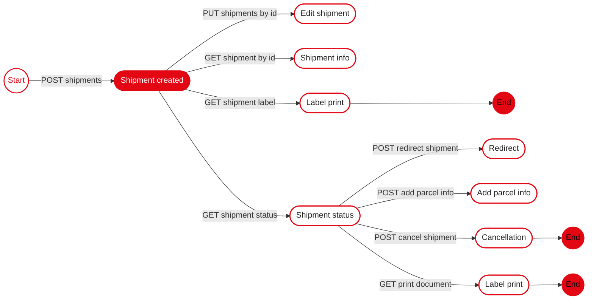

> For the complete documentation index, see [llms.txt](https://api-portal.novapost.com/llms.txt). Markdown versions of documentation pages are available by appending `.md` to page URLs; this page is available as [Markdown](https://api-portal.novapost.com/methods/methods/shipments.md).

# Shipments

<details>

<summary>List of Shipment Methods</summary>

<table data-search="false"><thead><tr><th width="239">Method name</th><th>Description</th></tr></thead><tbody><tr><td><a href="/methods/methods/shipments/create-shipments.md"><strong>Create Shipment</strong></a></td><td><p>Create a Shipment Document. This API method is engineered to streamline the process of generating a shipping document for logistics operations through Nova Post. By submitting key data, such as the originating and destination addresses for the shipment, users can effortlessly create a document detailing the transportation of goods. This method includes optional fields for customs authorities, accommodating shipments that cross borders. The API response will provide the unique identifier of the generated document along with other relevant information.</p><p><strong>Settlement validation rules</strong>: For shipments <strong>to or from Moldova and Ukraine</strong>, the settlement (city) must be successfully resolved. If the provided city value cannot be matched to a settlement, the request will fail with the error: <code>validation.condition.recipient_settlement_not_defined</code>.</p><p>Additional requirement: For shipments that require customs clearance (imports), the client invoice must be uploaded as a file through the <a href="/methods/methods/shipments/uploads-file.md">POST /shipments/uploads/{id}</a> method (after shipment creation).</p></td></tr><tr><td><a href="/methods/methods/shipments.md#get-shipments"><strong>Find Shipments List</strong></a></td><td>This API method enables you to retrieve a list of transportation documents (shipments) that you have created. By making a request with this method, you can access the transportation documents that belongs to you or your account. The response will include details of each shipment, such as the shipment ID, number, recipient, cargo detail, and other relevant information.</td></tr><tr><td><a href="#put-shipments-id"><strong>Update Shipment Document</strong></a></td><td><p></p><p>This API method enables you to update an existing transportation document by providing the document ID and the complete set of updated data. By specifying the document ID and including all the necessary information, you can replace the old document with the new data provided in the request. The response will typically indicate the success of the update operation and may include details of the modified document.</p><p>Update restrictions:</p><ul><li>Shipment data can be updated <strong>only while the shipment is in the <code>ReadyToShip</code> status</strong>.</li><li>Updates are allowed <strong>only if the shipment label has not been printed</strong>.</li><li>If the shipment is not in the <code>ReadyToShip</code> status or the shipment label has already been printed, the update request will be rejected with a validation error.</li></ul></td></tr><tr><td><a href="#delete-shipments-id"><strong>Delete Shipment Document</strong></a></td><td><p>This method allows you to delete a shipment document based on its unique identifier (ID). To successfully remove the document from the system, the request must include its ID. The response will indicate the success of the operation.</p><p><strong>Implementation Details for Different Regions:</strong></p><p><strong>1. Europe:</strong></p><ul><li>The method primarily expects a unique ID (Ref ID) of the document.</li><li>Additionally, deletion using the shipment number (e.g., <code>SHPL0123456789</code>) is also supported.</li></ul><p><strong>2. Ukraine:</strong></p><ul><li>Deletion is supported only by Ref ID (unique identifier of the document).</li><li>Deletion using the shipment number (e.g., waybill number) is not supported.</li></ul></td></tr><tr><td><a href="/methods/methods/shipments/return.md"><strong>Create Light Return Shipment</strong></a></td><td><p>Creates a return shipment after the original order has been delivered. This method allows customers to create a return shipment after delivery — regardless of who handled the last mile (Nova Post or a partner).</p><p>ℹ️ <strong>Information:</strong> The return can be created only if the parent shipment has the <strong>Delivered</strong> status and includes the <strong>AllowedLightReturn</strong> service. The current status of a shipment can be found in the <code>"items" → "statusCode"</code> field of the <a href="#get-shipments">Find documents</a> method. <strong>AllowedLightReturn</strong> defines the number of days within which the recipient can initiate a return after the delivery. Internally, the system verifies several conditions before allowing a Light Return shipment to be created:</p><ul><li>The parent shipment status must be one of: <code>Issued (9, 10, 11, 106)</code>.</li><li>The system calculates the allowed return period using the following logic: <code>finalDate = toTZ(parentShipment.RecipientDateTime) + returnDays + 1 day</code> where returnDays is taken from the AllowedLightReturn service, and toTZ applies the relevant system time zone (e.g., EU region).</li><li>The return can be created only if the current time (nowTZ) is earlier than finalDate.</li><li>The system also checks that no Light Return has already been created for the same parent shipment.</li></ul><p>If all these conditions are met, the return creation request is accepted; otherwise, the system responds with a validation error indicating why the return is not permitted.</p><p><strong>How the Light Return Shipment works</strong></p><ul><li>The request must include one <strong>required parameter</strong> — <code>number</code> (the parent shipment number). <strong>All other parameters are optional</strong>.</li><li>The customer may specify a valid branch or address directly for the return.</li><li>If <strong>optional parameters</strong> are not specified, their values are automatically inherited from the parent shipment.</li><li><p>The method behavior depends on the shipment direction:</p><ul><li>For <strong>UA-UA</strong> direction: the method works for parent deliveries to <strong>Postomat, PUDO, or address</strong>.</li><li>For <strong>EU-EU</strong> direction: the method works for parent deliveries to <strong>PUDO or address</strong>. It is not supported if the parent shipment was delivered to a <strong>Postomat</strong>.</li></ul></li><li>If parent delivery was to an address, a pickup is created automatically. A pickup request is created only if the return wasn’t sent from a branch.</li></ul><p>When the return is created, the system automatically generates a return waybill. For more information on creating a parent shipment, see <a href="/methods/methods/shipments/create-shipments.md">Create documents</a></p></td></tr><tr><td><a href="/methods/methods/shipments/delivery-cost.md"><strong>Calculate delivery cost</strong></a></td><td>This API method allows you to calculate the estimated delivery cost and delivery time for your cargo. The delivery cost and delivery time are calculated based on factors such as weight, dimensions, destination, and shipping method. By providing the necessary details of your cargo and shipment, you can obtain an estimated cost for delivering the goods. The response will typically include the calculated cost and the scheduled delivery date based on the provided information.</td></tr><tr><td><a href="/methods/methods/shipments/verification-status-of-ua-world.md"><strong>Get Verification status of UA→World shipments</strong></a></td><td>Returns verification statuses for international shipments for the UA→World direction (“international shipment from Ukraine to World”). Responses and errors from the core system are proxied unchanged.</td></tr><tr><td><a href="/methods/methods/shipments/uploads-file.md"><strong>Shipments uploads file</strong></a></td><td><p>Uploads supporting documents to a specific shipment by its ID. This method is used for attaching invoices, product specifications, customs declarations, or other shipment-related documents required for processing and clearance. Files are stored and linked to the shipment, ensuring better traceability and compliance.</p><p>⚠️ Region restriction: This method is available only for European shipments (EU/EU and EU/UA directions). It is not available for shipments originating from Ukraine.</p><p>File naming: • If the "fileName" parameter is provided, the uploaded file will be stored with that name. • If "fileName" is not provided, the default file name will be set to "invoice".</p><p>Use cases:</p><ol><li>"I want to upload a client invoice in PDF to shipment 980911" - send the base64-encoded content in "file", set <code>"fileName": "invoice.pdf"</code>.</li><li>"I want to attach a product photo in JPEG" - encode the photo in base64, set <code>"fileName": "product-photo.jpeg"</code>.</li></ol></td></tr><tr><td><a href="/methods/methods/shipments/print-documents.md"><strong>Print Shipment Documents</strong></a></td><td>This API method allows you to retrieve a transportation document marking in PDF format by providing the document number. The document marking is a printable document that clients can attach or affix to their cargo when sending it. By specifying the document number in the request, you can generate a PDF file containing the document marking for easy printing.</td></tr><tr><td><a href="/methods/methods/shipments/tracking-shipment.md#get-shipments-tracking-history"><strong>BasicTracking</strong></a></td><td><p>This API method enables you to retrieve the status of a shipment by providing the transportation document number. By specifying the document number in the request, you can obtain information about the current location or status of the shipment, providing clients with real-time updates on the progress of their cargo.</p><p>🔸This method works <strong>only with the transportation document number (shipment number)</strong> and does <strong>not support searching by client order numbers or any external identifiers</strong>.</p><p>🔸<strong>BasicTracking</strong> provides a simplified tracking response focused on the shipment’s status history and, optionally, its related shipment numbers. Unlike <strong>FullTracking</strong>, it does not return detailed routing information, parcel-level data, undelivery reasons, return/redirect records, or extended metadata. This method is intended for quick, lightweight status checks.</p></td></tr><tr><td><a href="/methods/methods/shipments/tracking-shipment.md#get-shipments-tracking"><strong>FullTracking</strong></a></td><td><p>This API method enables you to retrieve the status of a shipment by providing the transportation document number. By specifying the document number in the request, you can obtain information about the current location or status of the shipment, providing clients with real-time updates on the progress of their cargo.</p><p>By default, the response contains the following data blocks:</p><ul><li>Current status of the shipment;</li><li>Tracking history;</li><li>Actual tracking history;</li><li>Description of the shipment;</li><li>Extended information about related shipments.</li></ul><p>If necessary, additional blocks can be included in the response by passing the appropriate parameters:</p><ul><li>withUndeliveryReason = true - adds an array of objects with information about the reasons for non-delivery of shipments.</li><li>withCreatedOnTheBasis = true - adds an array of objects with information about returns or forwarding associated with the shipment.</li></ul><p>🔸<strong>FullTracking</strong> provides a comprehensive tracking response containing detailed shipment status data, full movement history, parcel descriptions, undelivery reasons, and information about related or derivative shipments. Unlike <strong>BasicTracking</strong>, it offers extended operational details and is designed for cases requiring full visibility into the shipment’s logistics lifecycle.</p></td></tr><tr><td><a href="/methods/methods/shipments/proof-of-delivery.md#get-shipments-shipmentnumber-attachments"><strong>List attachments</strong></a></td><td>Returns a list of available shipment-related attachment files (photos and/or signature) for the specified shipment <strong>only if the shipment belongs to the authenticated client</strong>.</td></tr><tr><td><a href="/methods/methods/shipments/proof-of-delivery.md#get-shipments-shipmentnumber-attachments-fileid"><strong>Download attachment</strong></a></td><td>Returns the <strong>stream of the file</strong> specified by fileId, if the shipment belongs to the authenticated client.</td></tr><tr><td><a href="/methods/methods/shipments/repeat-delivery.md#post-shipments-modification-repeat-delivery"><strong>Create Repeat Delivery</strong></a></td><td><p>This method creates a Repeat Delivery request for a shipment that is currently stored at a long-term storage warehouse (LTS).</p><p>Key rules:</p><ul><li>Available only for shipments currently at long-term storage (LTS).</li><li>A maximum of 4 completed Repeat Delivery services is allowed per shipment.</li><li>A Repeat Delivery service cannot be ordered if the shipment already has a Redirecting, Return, or Repeat Delivery request in the <code>NeedProcessing</code> or <code>InProgress</code> status.</li></ul></td></tr><tr><td><a href="/methods/methods/shipments/repeat-delivery.md#delete-shipments-modification-repeat-delivery-delete-shipmentid"><strong>Cancel Repeat Delivery</strong></a></td><td><p>The method cancels the current active Repeat Delivery request associated with the specified shipment.</p><p>Use this method when you need to cancel a repeat delivery request that has not yet been processed. Cancellation is available only while the repeat delivery order is still being processed.</p><p><strong>Key rules:</strong></p><ul><li>Cancellation is available only while the repeat delivery order is still being processed.</li><li>Once a repeat delivery has been completed, it cannot be cancelled.</li></ul></td></tr><tr><td><a href="/methods/methods/shipments/shipment-redirect.md"><strong>Create a shipment redirect</strong></a></td><td><p>The method allows you to create a redirect for an existing Nova Post shipment and change its delivery location without creating a new shipment.</p><p>Using this method, a shipment can be redirected:</p><ul><li>to a branch;</li><li>to a parcel locker;</li><li>to the recipient's address.</li></ul><p>For the new delivery location, only one addressing method must be used:</p><ul><li><code>recipient.divisionId</code> — for delivery to a branch or parcel locker;</li><li><code>recipient.addressParts.street</code> together with the other required <code>recipient.addressParts</code> fields — for address delivery.</li></ul><p>🔸Do not provide <code>recipient.divisionId</code> and <code>recipient.addressParts.street</code> at the same time. If neither of these fields is provided, the request will fail validation.</p><p>After a redirect is successfully created, there is no need to create a new shipment. The redirect is applied to the existing shipment.</p></td></tr></tbody></table>

</details>

<details>

<summary>Shipment API Interaction Flow</summary>



</details>

## Find Shipments List

> This API method enables you to retrieve a list of transportation documents (shipments) that you have created. By making a request with this method, you can access the transportation documents that belongs to you or your account. The response will include details of each shipment, such as the shipment ID, number, recipient, cargo detail, and other relevant information.<br>

```json
{"openapi":"3.0.0","info":{"title":"API Nova Post","version":"1.0.0"},"tags":[{"name":"Shipments"}],"servers":[{"description":"sandbox","url":"https://api-stage.novapost.com/v.1.0/"},{"description":"production","url":"https://api.novapost.com/v.1.0/"}],"security":[{"JWT":[]}],"components":{"securitySchemes":{"JWT":{"type":"apiKey","in":"header","name":"Authorization","description":"Authorization JWT-token with a lifetime of 1 hour in header"}},"responses":{"Unauthorized":{"description":"Unauthorized","content":{"application/json":{"schema":{"$ref":"#/components/schemas/Error"}}}},"NotFound":{"description":"The specified resource was not found","content":{"application/json":{"schema":{"$ref":"#/components/schemas/Error"}}}},"Validation":{"description":"Validation error","content":{"application/json":{"schema":{"$ref":"#/components/schemas/Error"}}}},"Time-out":{"description":"Connection time-out","content":{"application/json":{"schema":{"$ref":"#/components/schemas/Error"}}}}},"schemas":{"Error":{"type":"object","properties":{"errors":{"type":"object","properties":{"":{"type":"string"}}}}}}},"paths":{"/shipments":{"get":{"tags":["Shipments"],"description":"This API method enables you to retrieve a list of transportation documents (shipments) that you have created. By making a request with this method, you can access the transportation documents that belongs to you or your account. The response will include details of each shipment, such as the shipment ID, number, recipient, cargo detail, and other relevant information.\n","parameters":[{"in":"query","name":"numbers[]","description":"Search shipments by transportation document number. Can accept either a single search number or an array of numbers for conducting the search.","schema":{"type":"string"}},{"in":"query","name":"ids[]","description":"Search shipments by transportation document ids.","schema":{"type":"integer","format":"int32"}},{"in":"query","name":"limit","description":"Max number of items to return on page.","schema":{"type":"integer","format":"int32","default":15}},{"in":"query","name":"page","description":"Number of page to return.","schema":{"type":"integer","format":"int32"}},{"in":"query","name":"inRegistry","description":"Flag showing whether the shipment is included in the registry. Only for European parcels.","schema":{"type":"boolean"}},{"in":"query","name":"registerNumber","description":"Number of the register that lists all shipments in the registry. Only for European parcels.","schema":{"type":"string"}},{"in":"query","name":"senderDivisionId","description":"DivisionId of the shipment sender.","schema":{"type":"integer","minimum":1}}],"responses":{"200":{"description":"shipments","content":{"application/json":{"schema":{"type":"object","properties":{"current_page":{"type":"integer","description":"Current page.","minimum":1},"last_page":{"type":"integer","description":"Total pages found.","minimum":1},"per_page":{"type":"integer","description":"Current objects` limit for a single page.","minimum":1},"total":{"type":"integer","description":"Total objects found.","minimum":0},"from":{"type":"integer","nullable":true},"to":{"type":"integer","nullable":true},"items":{"type":"array","description":"Items` information in the invoice.","items":{"type":"object","properties":{"id":{"type":"string","description":"A unique identifier assigned to each shipment, facilitating internal operations such as modifications, system searches, and deletion of shipments. The 'id' serves as a key reference for administrative and logistical processes within the delivery system, allowing precise access and management of shipment records.","minimum":1},"version":{"type":"integer","description":"Version of the document, each change of the document is +1."},"number":{"type":"string","description":"Transportation document number.","pattern":"^[A-Z]{4}\\d{10}$"},"dateTime":{"type":"string","description":"Document creation datetime."},"scheduledDeliveryDate":{"type":"string","description":"Scheduled delivery date.","nullable":true},"closingDate":{"type":"string","description":"Document closing date. Displayed after successful delivery.","nullable":true},"createdAt":{"type":"string","description":"Datetime of creation."},"updatedAt":{"type":"string","description":"Datetime of update."},"deletedAt":{"type":"string","description":"Datetime if removed, otherwise is null.","nullable":true},"userCreate":{"type":"string","description":"Internal data, not for use."},"status":{"type":"string","description":"The actual status of the document (e.g. `ReadyToShip`, `Accepted`, `Issued`, `Draft`, `Deleted`)."},"gtid":{"type":"string","description":"Internal data, not for use."},"paymentStatus":{"type":"string","description":"Status of payment for delivery services (e.g. `Paid`, `NeedPay`, `ContractAfterPayment`)."},"currencyCode":{"type":"string","description":"Currency code according to the conditions of the payer contract, according to iso-4217 standard."},"parcelsAmount":{"type":"integer","description":"Amount of objects in parcels.","minimum":1},"clientOrder":{"type":"string","description":"Represents all potential order identifiers associated with the shipment. These identifiers are set by the customer for internal tracking purposes and are crucial for tracking the shipment throughout its journey. All entered values can be tracked in the shipment's tracking system.","maxLength":50},"note":{"type":"string","description":"Any additional information or special instructions that pertain to the order can be included here. This could encompass delivery instructions, special handling requests, or other pertinent details that facilitate the handling and processing of the shipment.","maxLength":255},"payerType":{"type":"string","description":"Information about who pays for delivery (e.g. `Sender`, `Recipient`, `ThirdPerson`)."},"payerContractId":{"type":"integer","description":"ID number of a person or organization that pays for delivery.","nullable":true},"payerContractNumber":{"type":"string","description":"Contains the contract number if `payerType` is set to `ThirdPerson`. Also this field can can contain the contract number of a sender as the payer when non-cash transactions are used.","nullable":true},"postomatCellReservation":{"type":"string","description":"Internal data, not for use."},"postomatOrderRef":{"type":"string","description":"Internal data, not for use."},"firstDayStorage":{"type":"string","description":"Start date of shipment storage.","nullable":true},"cargoAutoReturnDate":{"type":"string","description":"Date of automatic return of the shipment, if the service is ordered.","nullable":true},"marketplacePartner":{"type":"string","description":"Internal data, not for use."},"registerNumber":{"type":"string","description":"Internal data, not for use."},"customerNote":{"type":"string","description":"Internal data, not for use."},"creationDateNote":{"type":"string","description":"Internal data, not for use."},"sender":{"type":"object","description":"Information about the sender. Parameter contains a few variables to describe person or organization who sending cargo (cargo owner).","properties":{"companyId":{"type":"integer","description":"Internal data, not for use.","nullable":true},"companyTin":{"type":"string","description":"The tax identification number (TIN) of a legal entity. \n\n🔹**Empty parameter if sender not a company.**\n","maxLength":20},"companyName":{"type":"string","description":"Company name, in case the sender is a legal entity.","maxLength":255},"phone":{"type":"string","description":"The contact phone number of the sender or the sender’s company representative.\n\nIt is required for shipment-related communication, including pickup coordination and issue resolution.\n\n**Format:** The phone number must be provided in **international format** according to the **E.164** standard.\n\nExample: 380XXXXXXXXX, 491234567890, 371XXXXXXXX\n\n**Restrictions:**\n- The sender's phone number must be valid and reachable in case of delivery issues.\n- If the number is submitted in a local (non-international) format, the system will attempt to **normalize** it, but such logic is limited and may not support all variations across countries.\n\nWe strongly recommend implementing **front-end validation** to ensure numbers are entered in the correct international format.\n","minimum":8,"maximum":15},"email":{"type":"string","description":"Sender`s E-mail."},"name":{"type":"string","description":"Contact person.","maxLength":100},"countryCode":{"type":"string","description":"Sender's country code, according to the ISO 3166-1 Alpha-2 standard. For example, PL.","pattern":"^[A-Z]{2}$"},"settlementId":{"type":"string","description":"Settlement id code."},"cityId":{"type":"integer","description":"City id code.","nullable":true},"address":{"type":"string","description":"Home address or warehouse description."},"addressParts":{"type":"object","description":"Sender's address in case of sending from the address. Parameter contains a few variables to describe sender`s pick up address or other place beside warehouses.","properties":{"postCode":{"type":"string","description":"Postal code. Symbols that specifies address for a proper sort of cargo, only for address delivery.","maxLength":10},"region":{"type":"string","description":"City region name, only for address delivery. Proper name can be used from settlement request.","maxLength":100},"city":{"type":"string","description":"City or town name, only for address delivery. Proper name can be used from settlement request.","maxLength":100},"street":{"type":"string","description":"Street name, only for address delivery.","maxLength":100},"building":{"type":"string","description":"Building number, only for address delivery.","maxLength":100},"block":{"type":"string","description":"Block.","maxLength":100},"flat":{"type":"string","description":"Apartment number, only for address delivery.","maxLength":10},"note":{"type":"string","description":"Additional information about sender`s address.","maxLength":100}}},"divisionId":{"type":"string","description":"Warehouse`s id code. If sending with warehouse, than this parameter must contain information."},"divisionCategory":{"type":"string","description":"Warehouse type."},"archive":{"type":"boolean","description":"Internal data, not for use."}}},"recipient":{"type":"object","description":"Information about the recipient. Parameter contains a few variables to describe person or organization who must receive cargo.","properties":{"companyId":{"type":"integer","description":"Internal data, not for use.","nullable":true},"companyTin":{"type":"string","description":"The tax identification number (TIN) of a legal entity.\n\n🔹**Empty parameter if recipient not a company.**\n","maxLength":20},"companyName":{"type":"string","description":"Company name, in case the sender is a legal entity.","maxLength":255},"phone":{"type":"string","description":"The contact phone number of the recipient or the recipient’s company representative. Used for delivery notifications and communication with the customer during shipment processing.\n\n**Format:** The phone number must be provided in **international format** according to the **E.164** standard.\n\nExample: 380XXXXXXXXX, 491234567890, 371XXXXXXXX\n\n**Restrictions:**\n- For deliveries to Nova Post branches in Europe, Ukrainian mobile numbers are acceptable.\n- For deliveries to **partner locations** (such as InPost, GLS, Venipak, Cargus, etc.) and **cross-border address deliveries**, the phone number must belong to a mobile operator in the recipient's country. If the phone number is submitted in a local (non-international) format, the system will attempt to **normalize** it to the international format, but the internal algorithm does not cover all possible cases. If your system does not support front-end validation of phone numbers, we recommend informing us about failed phone number cases so we can assess potential improvements to the normalization logic.\n","minimum":8,"maximum":15},"email":{"type":"string","description":"Recipient`s E-mail."},"name":{"type":"string","description":"Surname and first name of the recipient or representative of the company, if it is a legal entity.","maxLength":100},"countryCode":{"type":"string","description":"Recipient's country code, according to the ISO 3166-1 Alpha-2 standard. For example, UA.","pattern":"^[A-Z]{2}$"},"settlementId":{"type":"string","description":"Settlement id code."},"cityId":{"type":"integer","description":"City id code.","nullable":true},"address":{"type":"string","description":"Home address or warehouse description."},"addressParts":{"type":"object","description":"Recipient's address in case of sending to the address. Parameter contains a few variables to describe recipient`s delivery address or other place beside warehouses.","properties":{"postCode":{"type":"string","description":"Postal code.","maxLength":10},"region":{"type":"string","description":"City region name, only for address delivery.","maxLength":100},"city":{"type":"string","description":"City or town name, only for address delivery.","maxLength":100},"street":{"type":"string","description":"Street name, only for address delivery.","maxLength":100},"building":{"type":"string","description":"Building number, only for address delivery.","maxLength":100},"block":{"type":"string","description":"Block.","maxLength":100},"flat":{"type":"string","description":"Apartment number, only for address delivery.","maxLength":100},"note":{"type":"string","description":"Additional information about sender`s address.","maxLength":100}}},"divisionId":{"type":"string","description":"Warehouse`s id code. If receiving with warehouse, than this parameter must contain information."},"divisionCategory":{"type":"string","description":"Warehouse type."},"archive":{"type":"boolean","description":"Internal data, not for use."}}},"parcels":{"type":"array","description":"Parcels` description block. Array contains objects, each object responsible for information about parcel.","items":{"type":"object","properties":{"number":{"type":"string","description":"Transportation document number.","pattern":"^[A-Z]{4}\\d{10}$"},"row_number":{"type":"integer","description":"Parcel number.","minimum":1},"untied":{"type":"boolean","description":"Internal data, not for use."},"cargo_category_id":{"type":"string","description":"Internal data, not for use."},"cargo_category_group":{"type":"string","description":"Parcel type."},"parcel_description":{"type":"string","description":"A brief description of the contents of the package.","maxLength":255},"insurance_cost":{"type":"number","description":"The amount of the declared value.","minimum":0,"exclusiveMinimum":true},"length":{"type":"integer","description":"The actual length of the parcel in mm.","minimum":1},"width":{"type":"integer","description":"The actual width of the parcel in mm.","minimum":1},"height":{"type":"integer","description":"The actual height of the parcel in mm.","minimum":1},"actual_weight":{"type":"integer","description":"The actual weight of the parcel in grams.","minimum":0,"maximum":2147483647},"volumetric_weight":{"type":"integer","description":"The volumetric weight of the parcel.","minimum":0,"maximum":2147483647},"length_check":{"type":"integer","nullable":true},"width_check":{"type":"integer","nullable":true},"height_check":{"type":"integer","nullable":true},"actual_weight_check":{"type":"integer","nullable":true},"volumetric_weight_check":{"type":"integer","nullable":true}}}},"services":{"type":"array","description":"Information about international shipping.","items":{"type":"object","properties":{"id":{"type":"integer","description":"Unique identifier. Internal data, not for use."},"service_id":{"type":"string","description":"Service`s identifier. Internal data, not for use."},"service_type":{"type":"string","description":"Type of service (e.g. `InternationalServices`, `MainService`, `AdditionalServices`)."},"service_name":{"type":"string","description":"Name of the service that is part of the shipment cost.\n\nExample: `Parcel international delivery (medium)`, `Parcel from home`.\n\nThis field represents one of the individual services that together form the total delivery cost. The response may include several such services depending on the selected delivery options and shipment configuration.\n\nTo obtain the full list of possible services and understand which combinations may apply, please contact your account manager.\n"},"parcel_number":{"type":"string","description":"Position number in the transportation document."},"payer_type":{"type":"string","description":"Information about who pays for delivery (e.g. `Sender`, `Recipient`, `ThirdPerson`)."},"amount":{"type":"number","description":"Number of objects in the position.","minimum":0},"price":{"type":"number","minimum":0},"discount":{"type":"number","minimum":0},"cost":{"type":"number","minimum":0},"cost_before_check":{"type":"number","nullable":true},"payment_status":{"type":"string","description":"Status of payment for delivery services (e.g. `Paid`, `NeedPay`, `ContractAfterPayment`, `FreeOfCharge`, `Holded`)."},"additional_parameters":{"type":"object","properties":{"cod":{"type":"integer","nullable":true,"description":"Money`s transfer information."},"date":{"type":"integer","nullable":true},"from":{"type":"integer","nullable":true},"to":{"type":"integer","nullable":true},"string":{"type":"integer","nullable":true},"fullName":{"type":"integer","nullable":true},"phone":{"type":"integer","nullable":true}}}}}},"onlineTracking":{"type":"object","description":"General statuses of the package movement (created/on the way/arrived/received). Types of statuses are displayed, into which detailed statuses are grouped.","properties":{"tracking_status_code":{"type":"integer","description":"Tracking status code."},"tracking_update_date":{"type":"string","description":"Tracking update date."},"short_description":{"type":"string","description":"Tracking short status description."},"long_description":{"type":"string","description":"Tracking full status description."},"info":{"type":"string"},"label":{"type":"string"}}},"tracking":{"type":"array","description":"Array of statuses representing all stages of the parcel's journey from the sender to the recipient with detailed information.","items":{}},"totalWeight":{"type":"integer","description":"Document total weight."},"totalInsuranceCost":{"type":"number","description":"Document total declared cost. The value must greater than zero.","minimum":1,"exclusiveMinimum":true},"totalCost":{"type":"number","description":"Cost for delivery services. The value must greater than zero.","minimum":1,"exclusiveMinimum":true},"invoice":{"type":"object","description":"Invoice data used for customs processing, including declared value, currency, and goods information.\n\nThe structure of the invoice object in the response depends on the data provided during shipment creation.\n\n🔹If some fields were not provided in the request, they may be absent in the response.\n","properties":{"customerNumber":{"type":"string","description":"Unique identifier/number of the invoice accompanying the goods in the shipment, generated by the client. Used for customs processing to link shipment goods with accompanying documentation.","maxLength":50,"nullable":true},"customerCreatedAt":{"type":"string","format":"date-time","description":"Date specified in the invoice accompanying the shipment."},"type":{"type":"string","description":"Type of client invoice accompanying the shipment and used for customs declaration."},"incoterm":{"type":"string","description":"Specifies the trade terms for the shipping agreement between the buyer and seller, based on selected standards from the Incoterms® rules."},"exportReason":{"type":"string","description":"Specifies the general reason for exporting items."},"cost":{"type":"number","description":"Total declared invoice value in the original currency."},"currency":{"type":"string","description":"ISO 4217 currency code of the invoice."},"payerFeesCustoms":{"type":"string","description":"Specifies who is responsible for paying for customs services."},"items":{"type":"array","description":"A detailed list of goods being shipped.\n\n🔹Objects may include only the fields provided during shipment creation. Optional fields may be absent in the response.\n","items":{"type":"object","properties":{"customerId":{"type":"string","description":"Client item identifier."},"hsCode":{"type":"string","description":"The Harmonized System code for each item."},"name":{"type":"string","description":"Item name in the original language used for customs identification."},"nameEng":{"type":"string","description":"Item name in English for international processing and documentation."},"material":{"type":"string","description":"Primary material of the item."},"materialEng":{"type":"string","description":"Material description in English."},"madeInCountryCode":{"type":"string","description":"Country of origin code (ISO 3166-1 alpha-2).","nullable":true},"producerAndModel":{"type":"string","description":"Manufacturer and model of the item."},"actualWeight":{"type":"integer","description":"Total weight of all units of the item in grams."},"measurementCode":{"type":"string","description":"Unit of measurement (e.g. pieces, kg)."},"amount":{"type":"number","description":"Quantity of the item in the specified unit."},"cost":{"type":"number","description":"Value per unit of the item in the sender’s currency."}}}}}}}}}}}}}},"401":{"$ref":"#/components/responses/Unauthorized"},"404":{"$ref":"#/components/responses/NotFound"},"422":{"$ref":"#/components/responses/Validation"},"503":{"$ref":"#/components/responses/Time-out"}},"summary":"Find Shipments List"}}}}
```

## Update Shipment Document

> This API method enables you to update an existing transportation document by providing the document ID and the complete set of updated data. By specifying the document ID and including all the necessary information, you can replace the old document with the new data provided in the request. The response will typically indicate the success of the update operation and may include details of the modified document.\
> \
> Update restrictions:\
> \- Shipment data can be updated \*\*only while the shipment is in the \`ReadyToShip\` status\*\*.\
> \- Updates are allowed \*\*only if the shipment label has not been printed\*\*.\
> \- If the shipment is not in the \`ReadyToShip\` status or the shipment label has already been printed, the update request will be rejected with a validation error.<br>

```json
{"openapi":"3.0.0","info":{"title":"API Nova Post","version":"1.0.0"},"tags":[{"name":"Shipments"}],"servers":[{"description":"sandbox","url":"https://api-stage.novapost.com/v.1.0/"},{"description":"production","url":"https://api.novapost.com/v.1.0/"}],"security":[{"JWT":[]}],"components":{"securitySchemes":{"JWT":{"type":"apiKey","in":"header","name":"Authorization","description":"Authorization JWT-token with a lifetime of 1 hour in header"}},"responses":{"Unauthorized":{"description":"Unauthorized","content":{"application/json":{"schema":{"$ref":"#/components/schemas/Error"}}}},"NotFound":{"description":"The specified resource was not found","content":{"application/json":{"schema":{"$ref":"#/components/schemas/Error"}}}},"Validation":{"description":"Validation error","content":{"application/json":{"schema":{"$ref":"#/components/schemas/Error"}}}},"Time-out":{"description":"Connection time-out","content":{"application/json":{"schema":{"$ref":"#/components/schemas/Error"}}}}},"schemas":{"Error":{"type":"object","properties":{"errors":{"type":"object","properties":{"":{"type":"string"}}}}}}},"paths":{"/shipments/{id}":{"put":{"tags":["Shipments"],"description":"This API method enables you to update an existing transportation document by providing the document ID and the complete set of updated data. By specifying the document ID and including all the necessary information, you can replace the old document with the new data provided in the request. The response will typically indicate the success of the update operation and may include details of the modified document.\n\nUpdate restrictions:\n- Shipment data can be updated **only while the shipment is in the `ReadyToShip` status**.\n- Updates are allowed **only if the shipment label has not been printed**.\n- If the shipment is not in the `ReadyToShip` status or the shipment label has already been printed, the update request will be rejected with a validation error.\n","parameters":[{"name":"id","in":"path","description":"Transportation document id.","required":true,"schema":{"type":"integer","format":"int32"}}],"requestBody":{"description":"Optional description in *Markdown*","required":true,"content":{"application/json":{"schema":{"type":"object","properties":{"status":{"type":"string","description":"Signifies the current status of the transportation document, tracking its progress through the shipping lifecycle. Statuses detail each critical phase:\n- `Draft`: The document is in its preliminary stage, not yet finalized.\n- `Accepted`: Reviewed and accepted, the document is ready for the next steps.\n- `Issued`: The document has been completed and is ready for shipping.\n- `ReadyToShip`: Indicates that the shipment is prepared for transport following the creation of the express waybill. Only this value can be specified when creating a shipment.\n- `Deleted`: The document has been deleted from the system.\n- `Returned`: The shipment has been returned to its sender.\n- `Utilized`: Indicates that the physical goods associated with the transportation document have been disposed of or destroyed and the document is closed.\n","enum":["ReadyToShip"]},"clientOrder":{"type":"string","description":"Represents all potential order identifiers associated with the shipment. These identifiers are set by the customer for internal tracking purposes and are crucial for tracking the shipment throughout its journey. All entered values can be tracked in the shipment's tracking system.","maxLength":50},"note":{"type":"string","description":"Any additional information or special instructions that pertain to the order can be included here. This could encompass delivery instructions, special handling requests, or other pertinent details that facilitate the handling and processing of the shipment.","maxLength":255},"deliveryType":{"type":"string","description":"Defines the tariff type to be applied to the shipment during creation or update.\n- `standard`: Standard international delivery tariff.\n- `economy`: Economy international delivery tariff.\n- `express`: Express international delivery tariff.\n\nIf the field is not provided, the tariff type is determined automatically according to current business rules, and the existing shipment update behaviour remains unchanged.\n\n**🔹This field is optional.**\n"},"payerType":{"type":"string","description":"Identifies who is responsible for the payment of delivery services. The payer type determines which party bears the cost:\n- `Sender`: The party sending the goods pays for the delivery.\n- `Recipient`: The party receiving the goods is responsible for the delivery cost.\n- `ThirdPerson`: A third party, not the sender or recipient, pays for the delivery services. When selecting 'ThirdPerson', the field 'payerContractNumber' must be populated with the contract number of the paying party. For more detailed information, refer to the article on [Payment for Delivery Services via Nova Post API](https://api-portal.novapost.com/en/api-methods/payment/).\n","enum":["Sender","Recipient","ThirdPerson"]},"payerContractNumber":{"type":"string","description":"This field is required when the 'payerType' is set to 'ThirdPerson'. It should contain the contract number. For clients from Ukraine, it is also acceptable to provide the tax identification number (EDRPOU) instead of the contract number. Additionally, this field must be completed for the sender as the payer when non-cash transactions are used. Failure to provide this information will default the payment method to cash. Ensure the information is accurate, as it is essential for processing the payment. For more detailed information, refer to the article on [Payment for Delivery Services via Nova Post API](https://api-portal.novapost.com/en/api-methods/payment/).","minLength":2,"maxLength":20,"nullable":true},"invoice":{"type":"object","description":"This object encapsulates the invoice details crucial for international shipments undergoing customs clearance. It presents the necessary data for customs authorities to process the consignment efficiently, including the assessment of duties and taxes, and to confirm adherence to import/export regulations. The structured format of the invoice ensures that all pertinent information is easily accessible and clear, facilitating a smoother transit across borders.","properties":{"customerNumber":{"type":"string","description":"Unique identifier/number of the invoice accompanying the goods in the shipment, generated directly by the client. It is used for customs processing (export and import clearance) because it ensures a clear link between the goods in the shipment and their accompanying documentation, including value, origin, and other necessary information for customs clearance.\n\nIf a client invoice exists in the shipment but its information is missing—specifically, its number—the shipment processing in the information system will be halted, the customs clearance period will be extended, and in the worst case, customs authorities may refuse clearance and initiate a return to the country of export.\n","maxLength":50,"nullable":true},"customerCreatedAt":{"type":"string","format":"date-time","description":"You must provide the date specified in the invoice accompanying the shipment.\nIf the date is not present in the client document, the shipment creation date may be used.\n\n**🔹This field is required if the** `invoice.customerNumber` **field is filled in.**\n","pattern":"^20[0-9]{2}-[0-9]{2}-[0-9]{2}T[0-9]{2}:[0-9]{2}:[0-9]{2}.[0-9]{6}Z$"},"type":{"type":"string","description":"Type of client invoice accompanying the shipment and used for customs declaration.\nThis field must reflect the actual type of document enclosed in the parcel.\nAvailable values:\n- `Invoice` — commercial invoice for shipments of a commercial nature\n- `ProformaInvoice` — proforma invoice for shipments of a non-commercial nature\n\n**🔹This field is required if the** `invoice.customerNumber` **field is filled in.**\n","enum":["Invoice","ProformaInvoice"]},"incoterm":{"type":"string","description":"Specifies the trade terms for the shipping agreement between the buyer and seller, based on selected standards from the Incoterms® rules. These terms define the allocation of shipping costs, insurance, customs duties, and the distribution of risk. Only a limited subset of Incoterms® is available for use:\n- `DAP`: Delivered at Place\n","enum":["DAP"]},"exportReason":{"type":"string","description":"Specifies the general reason for exporting items, which is required for customs and other regulatory bodies. This classification helps in understanding the type of shipment without getting into specifics. It's used to categorize shipments at a high level for smoother processing through customs. The available options are:\n- `ForPersonalPurposes`: Items are for personal use or gifts.\n- `Selling`: Items are meant for sale.\n- `Repair`: Items being sent for repair.\n- `Return`: Items are being returned to the sender or manufacturer.\n- `Other`: Any reason not covered by the other options.\n","enum":["ForPersonalPurposes","Selling","Repair","Return","Other"]},"cost":{"type":"number","description":"Total declared invoice value in the original currency. Used for customs and shipment declarations.\n\n**🔸Values are validated for decimal precision, and digits beyond two decimal places are ignored.**\n\n**🔹This field is required for shipments crossing the EU border or going outside the EU.**\n","minimum":0,"maximum":9999999.99},"currency":{"type":"string","description":"ISO 4217 currency code of the invoice. All items in the invoice must use the same currency.\n\n**🔹This field is required for shipments crossing the EU border or going outside the EU.**\n","pattern":"^[A-Z]{3}$"},"payerFeesCustoms":{"type":"string","description":"Specifies who is responsible for paying for customs services. The parameter determines which party bears the costs:\n- `Sender`: The party sending the goods pays for the customs duties.\n- `Recipient`: The party receiving the goods is responsible for the customs duties costs.\n- `ThirdPerson`: A third party can only pay for customs services if this is permitted and the payer for delivery services is also a third party.\n\nThe default value is `Recipient`.</br>\nThis value will also be applied automatically if the parcel exceeds the maximum allowed value (in the recipient country’s currency) for which the sender is permitted to pay customs duties.\n\n**🔹This parameter is required and valid only for the UA-EU direction.**\n","enum":["Sender","Recipient","ThirdPerson"]},"items":{"type":"array","description":"A detailed list of goods being shipped, including descriptions and values, essential for customs declarations and assessing duties.","items":{"type":"object","properties":{"customerId":{"type":"string","description":"Client item identifier."},"hsCode":{"type":"string","description":"The Harmonized System code for each item, a standardized numerical method of classifying traded products.\n  This field is required for international shipments that pass through customs clearance. You can obtain the valid `hsCode` from the Cargo Classifiers (UKT ZED) dictionary.\n  Validation rules:\n  - **If the sender or recipient country is Moldova (MD) or Canada (CA):**\n    - The `hsCode` must consist of exactly 10 numeric characters.\n    - If the input is longer than 10 digits, it will be **truncated** on the right.\n    - If it contains fewer than 10 digits - validation error.\n  - **For all other countries:**\n    - The `hsCode` must contain **between 8 and 10 numeric characters** (inclusive).\n    - If fewer than 8 digits – validation error.\n  - **All non-digit characters will be stripped automatically before validation.**\n  - **If the value of the `hsCode` field is** `210690` **or** `630900`**, the following conditions must be met:**\n    - The `measurementCode` must be set to `kg`.\n    - Each item with this `hsCode` must be unique — the invoice must not contain more than one item with code `210690` or `630900`.\n    - The amount value must not exceed 10.\n    \n**🔹This field is required for shipments crossing the EU border or going outside the EU.**\n","maxLength":255,"nullable":true},"name":{"type":"string","description":"Represents the item's name in the local language, offering an accurate description for customs and logistical planning. The name should correspond with terminologies found in the Cargo Classifiers (UKT ZED) dictionary, ensuring compliance with standard classification codes. This detailed description aids in precise item identification during the customs clearance process.\nThis field supports Unicode encoding, permitting the inclusion of special characters and symbols using the \\uXXXX format. This capability allows for precise representation of item names in languages that incorporate non-Latin characters, enhancing clarity and understanding across diverse regulatory environments.\n","maxLength":512},"nameEng":{"type":"string","description":"Specifies the item's name in English, critical for ensuring that the product is identifiable and understandable across international trade and logistics channels. The English name simplifies communication and documentation processes when dealing with international partners and authorities, aiding in the seamless facilitation of global shipments.\nSimilar to the 'name' field, this parameter also supports Unicode encoding. Using the \\uXXXX format, it accommodates the accurate rendering of any special characters necessary for the correct representation of the item's name in English.\n","maxLength":512},"materialEng":{"type":"string","description":"The description of the item's material in English, aiding in the universal understanding of the product's composition.","maxLength":255},"madeInCountryCode":{"type":"string","description":"The ISO 3166-1 alpha-2 code indicating the country of manufacture, essential for determining import duties and compliance with trade agreements.","pattern":"^[A-Z]{2}$","nullable":true},"producerAndModel":{"type":"string","description":"The parameter represents the manufacturer and model of the device when creating a shipment. Both values are included in a single parameter. This parameter is mandatory for the following categories:\n- Electrical appliances\n- Laptops\n- Phones\n- Large and small household appliances\n- Other similar items\n","maxLength":255,"nullable":true},"actualWeight":{"type":"integer","description":"Actual total weight of all units of the item in grams (g), crucial for calculating shipping costs and ensuring the shipment complies with carrier limitations.\n\nExpected unit: grams (g)\n\nOnly precision up to 10 grams (0.01 kg) is supported. Values not divisible by 10 g will be rounded down to the nearest lower multiple of 10 g.\n\n⚠️IMPORTANT: Please round weight values to the nearest 10 g before sending, to avoid unexpected adjustments.\n","minimum":1,"maximum":2147483647,"nullable":true},"measurementCode":{"type":"string","description":"The unit of measurement for the item quantity, such as pieces, kilograms, meters, etc., standardizing the way quantities are reported.","maxLength":255},"amount":{"type":"number","description":"The quantity of the item being shipped, necessary for inventory and customs documentation. Value in the units of measurement corresponding to the field `measurementCode`.","minimum":0,"maximum":9999999.99},"cost":{"type":"number","description":"The value per single unit of the item in the sender's currency, important for insurance and customs valuation.\n\n**🔸Values are validated for decimal precision, and digits beyond two decimal places are ignored.**\n","minimum":0,"maximum":9999999.99}}}}}},"services":{"type":"array","description":"Contains information about additional services for the shipment.","properties":{"shipmentParcelRowNumber":{"type":"integer","nullable":true,"description":"Specifies the row number of the parcel to which the service is applied.\nThe value must correspond to the `rowNumber` of an existing parcel in the `parcels` array.\n\nFor services applied to the **entire shipment** (for example, `ExpBackwardGoods`), this field must be set to `null`.\n"},"serviceCode":{"type":"string","description":"The code indicating the service.\n\n**A list of available codes and descriptions of their meanings:**\n- `ExpBackwardGoods` — enables return delivery option for parent shipment\n- `BackwardDelGoods` — confirms return delivery in child shipment\n\n- `ExpBackwardCreditDoc` — Enables return delivery of signed documents for domestic document shipments within Moldova. The service is available only for legal entities and only for shipments with the “Documents” type. The return shipment is created as a separate document delivery (by courier or operator), and the payer is always the Recipient under a non-cash contract. Not available for Parcel Locker and PUDO service channels. In the first iteration, the service is enabled only for selected legal entities.\n\n🔹**This field is required for the `services` group.**\n"},"amount":{"type":"number","description":"The total amount the recipient must pay under the COD service.\n\n🔹**This field is required for the `services` group.**\n"},"contractNumber":{"type":"string","nullable":true,"description":"Contract number of the payer responsible for the selected service.\nThis parameter is used to identify the contractual agreement under which the service is paid.\n\nThe field is required when the service payer is a **third party** or when non-cash payment terms are applied. If not provided, the payment may be processed according to default billing rules.\n"},"payerType":{"type":"string","description":"Determines who is responsible for paying for the service. The payer type determines which party bears the costs:\n\n- `Recipient` — The only allowed value for the COD service.\n- `Sender`, `Recipient` — Allowed payer values for the ExpBackwardGoods service.\n- `Sender`, `Recipient`, `ThirdPerson` — Allowed payer values for the BackwardDelGoods service.\n\n🔹**This field is required for the `services` group.**\n"},"additionalParameters":{"type":"string","description":"Additional parameters for the service.","properties":{"backwardDelivery":{"type":"array","description":"Additional parameters for configuring return delivery.\n\n🔹**These parameters are mandatory and required only for the ExpBackwardGoods service**\n","items":{"type":"object","properties":{"description":{"type":"string","description":"Description of the goods to be returned.\nThis value is used for informational and operational purposes during the return delivery process.\n"}}}}}}}},"parcels":{"type":"array","description":"Parcels` description block. Array contains objects, each object responsible for information about parcel.","items":{"type":"object","properties":{"cargoCategory":{"type":"string","description":"Specifies the type of the shipment, helping to categorize the goods for logistics and customs processing. The category impacts how the shipment is handled, its shipping cost, and the required documentation. Available categories are:\n- `parcel`: Small to medium-sized packages, typically for consumer goods and retail items.\n- `documents`: Postal shipments containing documents such as letters, contracts, and official papers. This category is specifically for items that weigh no more than 1 kg and have dimensions not exceeding 35 cm in length, 25 cm in width, and 2 cm in height.\n- `cargo`: Larger and bulk items, including pallets or containers, meant for commercial shipping and large-scale transport.\n- `pallet`: Type of cargo formed as a pallet shipment with fixed dimensions and weight limits, available in the Business Cabinet of Europe for legal entities:\n  - Up to 250 kg, area ~0.48 m², dimensions 80 × 60 × 170 cm\n  - Up to 500 kg, area ~0.96 m², dimensions 120 × 80 × 170 cm\n  - Up to 750 kg, area ~1.2 m², dimensions 120 × 100 × 170 cm\n  - Up to 1000 kg, area ~1.2 m², dimensions 120 × 100 × 170 cm\n","enum":["parcel","documents","cargo","pallet"]},"parcelDescription":{"type":"string","description":"This field requires a concise description of the contents within the shipment, providing essential information on the nature of the items enclosed. This description aids in the logistics process, offering a clear understanding of the package contents for transportation planning and customs clearance. The summary should include details like the type of items, their purpose, and any other relevant information that describes the contents. It’s crucial for ensuring that the shipment complies with shipping regulations and facilitates smooth customs processing.\nAdditionally, this field supports data in Unicode encoding, allowing for the inclusion of special characters and symbols using the \\uXXXX format. This feature is particularly useful for languages that use non-Latin characters, ensuring accurate representation of item descriptions across diverse linguistic contexts.\n","maxLength":255},"insuranceCost*":{"type":"number","format":"float","description":"Represents the declared value of the shipment for insurance coverage. This value indicates the maximum compensation amount in the event of damage or loss during transit. It is important to accurately declare this value to match the actual worth of the shipment contents, as underdeclaring can result in insufficient compensation.\n\n**Currency handling:**\n- If `insuranceCurrencyCode` is **not provided**, the value must be specified in the **currency of the sender's country**.\n- If `insuranceCurrencyCode` **is provided**, the value can be specified in any supported currency (ISO 4217). The system will automatically convert it to the sender's country currency before further processing.\n\n🔸**When** `insuranceCurrencyCode` **is used, all parcels must specify the same currency code. Mixed or partially filled currency values will result in a validation error.**\n\n**The value must always be greater than 0, regardless of the shipment direction.**\"\n","minimum":1,"exclusiveMinimum":true},"insuranceCurrencyCode":{"type":"string","description":"ISO 4217 currency code for the declared insurance value (`insuranceCost`). \n\n- When provided, the system converts `insuranceCost` to the sender's country currency automatically. \n- If used, all parcels must have the same `insuranceCurrencyCode`.\n\n🔹**This field is optional.**\"\n","pattern":"^[A-Z]{3}$"},"rowNumber":{"type":"integer","description":"Sequential identifier for each parcel within a shipment, used to organize and track individual packages, especially when multiple items are involved. If the shipment contains only one package, the value should be 1.","minimum":1},"untied":{"type":"boolean","description":"Allows cancellation of individual parcels within a multiparcel shipment before the shipment reaches the **Accepted** status. To cancel one parcel, the merchant must include the full array of all parcels in the update request and set the parameter `untied: true` for the parcel to be cancelled.\n\n⚠️IMPORTANT:\n- The first parcel (`rowNumber: 1`) cannot be detached. If it contains an error, the entire shipment must be cancelled and recreated.\n- When `untied` is used for **one parcel**, it must be included for **all parcels** in the request.\n- If a non-existent `rowNumber` is marked as `untied: true`, the system will return the error: `Impossible to delete a non-existent parcel`.\n- If not all parcels are provided in the request, the system will return: `Required parcel [rowNumber] is missing.`\n"},"width":{"type":"integer","description":"The parcel's width measured in millimeters, used alongside length and height to compute the total volume for logistical planning.","minimum":1},"length":{"type":"integer","description":"The parcel's length measured in millimeters, used alongside height and width to compute the total volume for logistical planning.","minimum":1},"height":{"type":"integer","description":"The parcel's height measured in millimeters, used alongside length and width to compute the total volume for logistical planning.","minimum":1},"actualWeight":{"type":"integer","description":"Actual total weight of all units of the item in grams (g), critical for shipping cost calculations and compliance with carrier weight limits.\n\nExpected unit: grams (g)\n\nOnly precision up to 10 grams (0.01 kg) is supported. Values not divisible by 10 g will be rounded down to the nearest lower multiple of 10 g.\n\n⚠️IMPORTANT: Please round weight values to the nearest 10 g before sending, to avoid unexpected adjustments.\n","minimum":1,"maximum":2147483647}}}},"sender":{"type":"object","description":"Information about the party sending the shipment, including details about an individual or organization responsible for the dispatch.","properties":{"companyTin":{"type":"string","description":"The tax identification number or equivalent identifier (EDRPOU, TIN, NIP, IČO) of a legal entity. \n\n🔹**Required for legal and customs documentation when the sender is a legal entity.**\n","maxLength":20,"nullable":true},"companyName":{"type":"string","description":"The official name of the sender's company. This field is used when the sender is a business entity, helping to identify the sending organization in documentation and records.","maxLength":100,"nullable":true},"eoriCode":{"type":"string","description":"The EORI code (Economic Operators Registration and Identification number) is used by the European Union to identify economic operators engaged in international trade. The sender's EORI code should be included in the invoice to ensure correct customs clearance and taxation when shipping goods to EU countries. The code is not mandatory but strongly recommended for international shipments to the EU, as it facilitates customs processing and helps avoid delays.","minLength":3,"maxLength":17,"nullable":true},"phone":{"type":"string","description":"The contact phone number of the sender or the sender’s company representative.\n\nIt is required for shipment-related communication, including pickup coordination and issue resolution.\n\n**Format:** The phone number must be provided in **international format** according to the **E.164** standard.\n\nExample: 380XXXXXXXXX, 491234567890, 371XXXXXXXX\n\n**Restrictions:**\n- The sender's phone number must be valid and reachable in case of delivery issues.\n- If the number is submitted in a local (non-international) format, the system will attempt to **normalize** it, but such logic is limited and may not support all variations across countries.\n\nWe strongly recommend implementing **front-end validation** to ensure numbers are entered in the correct international format.\n"},"email":{"type":"string","description":"Email address of the sender, providing an electronic means of contact for updates, inquiries, and important notifications about the shipment."},"name":{"type":"string","description":"The full name of the individual sender or the primary contact person for a company sender. This name is used in all correspondences and documents related to the shipment.","maxLength":100},"ioss":{"type":"string","description":"The IOSS (Import One-Stop Shop) number is an optional input used to facilitate the VAT declaration process for shipments from non-EU countries with a declared value of up to EUR 150. It is utilized by shippers using the IOSS process to simplify customs procedures for deliveries to private customers in the EU. This field is available for shipments where the sender's country is outside the EU and the destination is within the EU.","maxLength":12,"pattern":"/^[a-zA-Z0-9]*$/u"},"countryCode":{"type":"string","description":"A two-letter code representing the sender's country, following the ISO 3166-1 Alpha-2 standard, indicating the country of origin for the shipment.","pattern":"^[A-Z]{2}$"},"divisionNumber":{"type":"string","description":"This field is mandatory for parcels that are dispatched from a post office division or parcel locker, requiring the unique identifier of the dispatch location to be specified.","nullable":true},"addressParts":{"type":"object","description":"This array of fields is required when shipping directly from an address, detailing the specific components of the location from which the parcel is dispatched. It includes detailed address information, ensuring the accurate identification of the pickup location.","properties":{"city":{"type":"string","description":"The name of the city from which the shipment is dispatched. It helps pinpoint the exact urban location for pickup or shipping.","maxLength":100},"region":{"type":"string","description":"Specifies the broader administrative area, like a state or province, encompassing the city, providing additional context for the shipment's origin.","maxLength":100},"street":{"type":"string","description":"Identifies the specific street address for the sender's location, crucial for accurate pickup or delivery operations.","maxLength":100},"postCode":{"type":"string","description":"The postal or ZIP code corresponding to the sender's address. It's essential for sorting and routing the shipment efficiently.","maxLength":10},"building":{"type":"string","description":"The building number or name at the specified street address, pinpointing the precise location for shipment collection.","maxLength":100},"flat":{"type":"string","description":"If applicable, the apartment or suite number within a building from which the shipment originates, ensuring pickup personnel can locate the sender's exact unit.","maxLength":10},"block":{"type":"string","description":"Indicates a specific block or section within a larger residential area or complex, if relevant, aiding in locating the sender's precise starting point for the shipment.","maxLength":100,"nullable":true},"note":{"type":"string","description":"Allows for the inclusion of additional details or instructions about the sender's address that might facilitate the pickup process, such as gate codes, specific entry points, or preferred contact times.","maxLength":100}}}}},"recipient":{"type":"object","description":"Information about the party receiving the shipment, detailing either an individual or an organization responsible for receiving the dispatched goods.","properties":{"companyTin":{"type":"string","description":"The tax identification number or equivalent identifier (EDRPOU, TIN, NIP, IČO) of a legal entity.\n\n🔹**Required for legal and customs documentation when the recipient is a legal entity.**\n","maxLength":20,"nullable":true},"companyName":{"type":"string","description":"The formal name of the recipient's company. Utilize this field when the recipient is a business entity, aiding in the identification of the receiving organization in documents and records.","maxLength":100,"nullable":true},"eoriCode":{"type":"string","description":"The recipient's EORI code is important for customs clearance when shipping goods to European Union countries, especially when sending to legal entities. The code is not mandatory but recommended, as it helps ensure smooth customs clearance and minimizes the risk of delays. The requirement for the recipient eoriCode depends on the type of goods being shipped:\n1. Non-excise goods: The EORI code is not mandatory if non-excise goods are being shipped from Ukraine to a legal entity in Europe. If the recipient does not have an EORI code, one will be automatically assigned.\n2. Excise goods: The EORI code is required for shipments of excise goods. The recipient must obtain an EORI code before the goods can be shipped.\n","minLength":3,"maxLength":17,"nullable":true},"phone":{"type":"string","description":"The contact phone number of the recipient or the recipient’s company representative. Used for delivery notifications and communication with the customer during shipment processing.\n\n**Format:** The phone number must be provided in **international format** according to the **E.164** standard.\n\nExample: 380XXXXXXXXX, 491234567890, 371XXXXXXXX\n\n**Restrictions:**\n- For deliveries to Nova Post branches in Europe, Ukrainian mobile numbers are acceptable.\n- For deliveries to **partner locations** (such as InPost, GLS, Venipak, Cargus, etc.) and **cross-border address deliveries**, the phone number must belong to a mobile operator in the recipient's country. If the phone number is submitted in a local (non-international) format, the system will attempt to **normalize** it to the international format, but the internal algorithm does not cover all possible cases. If your system does not support front-end validation of phone numbers, we recommend informing us about failed phone number cases so we can assess potential improvements to the normalization logic.\n"},"email":{"type":"string","description":"The email address of the recipient, serving as a digital contact point for shipment updates, inquiries, and essential notifications."},"name":{"type":"string","description":"The complete name of the individual recipient or the primary contact for a company recipient. This is the name used for all shipping-related correspondence and documentation.","maxLength":100},"countryCode":{"type":"string","description":"A two-letter code that identifies the recipient's country, adhering to the ISO 3166-1 Alpha-2 standard, which specifies the shipment's destination country.","pattern":"^[A-Z]{2}$"},"divisionNumber":{"type":"string","description":"This field is mandatory for parcels intended to be collected from a post office division or parcel locker, requiring the insertion of the unique identifier for the designated location.","nullable":true},"addressParts":{"type":"object","description":"This array of fields is necessary when the shipment is directed to a specific address, outlining the precise location details to which the parcel is to be delivered. It encompasses comprehensive address information to ensure the exact identification of the delivery location.","properties":{"city":{"type":"string","description":"The city to which the shipment is being delivered. This detail ensures the parcel is directed to the correct urban area for the recipient.","maxLength":100},"region":{"type":"string","description":"Specifies the recipient's state or province within the destination country, crucial for accurate shipment routing and delivery. When sending to the USA, it's essential to include a two-letter state code, such as `WA` for Washington or `DC` for the District of Columbia, according to the ISO 3166-2:US standard.","maxLength":100},"street":{"type":"string","description":"The street name of the recipient's address, vital for pinpointing the exact delivery spot.","maxLength":100},"postCode":{"type":"string","description":"The postal or ZIP code for the recipient's address, critical for the precise sorting and routing of the parcel to its final destination.","maxLength":10},"building":{"type":"string","description":"Specifies the building number or name at the recipient's address, guiding the delivery to the exact building within a given street.","maxLength":100},"flat":{"type":"string","description":"The apartment or suite number, if the delivery is to a multi-unit building, ensuring the parcel reaches the specific unit of the recipient.","maxLength":10},"block":{"type":"string","description":"Identifies a block or section within a larger complex or residential area for the recipient, useful in large housing developments to further narrow down the delivery point.","maxLength":100,"nullable":true},"note":{"type":"string","description":"The space for any additional recipient-related address instructions or details that might assist in the delivery process, such as security instructions, specific doors for delivery, or preferred delivery times.","maxLength":100}}},"registrationAddressRecipient":{"type":"object","description":"The registrationAddressRecipient object provides a detailed breakdown of the recipient's registered address and is required when shipping to countries with specific customs requirements, such as Germany, Slovakia, Hungary, and France. This ensures compliance with local regulations and facilitates smooth customs processing. \nThe object allows for a precise and complete representation of the recipient's address, which is especially important for international shipments to countries with strict customs regulations.\n","properties":{"city":{"type":"string","description":"The name of the city where the recipient is registered. It must match the local naming conventions for accurate identification.\n\n**🔹This field is required for shipments to countries with specific customs requirements, including Germany, Slovakia, Hungary, and France.**\n","maxLength":100},"street":{"type":"string","description":"The name of the street in the recipient's address. It must match the local naming conventions for accurate identification.\n\n**🔹This field is required for shipments to countries with specific customs requirements, including Germany, Slovakia, Hungary, and France.**\n","maxLength":100},"zipCode":{"type":"string","description":"The postal code of the recipient's registered address.\n\n**🔹This field is required for shipments to countries with specific customs requirements, including Germany, Slovakia, Hungary, and France.**\n","maxLength":10},"building":{"type":"string","description":"The building number or name where the recipient is registered.\n\n**🔹This field is required for shipments to countries with specific customs requirements, including Germany, Slovakia, Hungary, and France.**\n","maxLength":100},"apartment":{"type":"string","description":"The flat or apartment number within the building.","maxLength":10},"state":{"type":"string","description":"The state or region where the recipient is registered. Required in some countries for detailed geographical identification.","maxLength":100}}}}}}}}}},"responses":{"202":{"description":"The shipment has been successfully updated. This response indicates that the specified transportation document's details have been modified according to the provided input parameters.","content":{"application/json":{"schema":{"type":"object","properties":{"id":{"type":"integer","description":"A unique identifier assigned to each shipment, facilitating internal operations such as modifications, system searches, and deletion of shipments. The 'id' serves as a key reference for administrative and logistical processes within the delivery system, allowing precise access and management of shipment records.","minimum":1},"number":{"type":"string","description":"The transportation document number provided to clients for tracking purposes and accessing printed forms. It also facilitates shipment searches within the system, offering a customer-friendly way to monitor shipment progress. While 'number' is used externally for tracking and documentation, it can also serve internal needs similar to 'id' for identifying shipments in certain system operations.","pattern":"^[A-Z]{4}\\d{10}$"},"scheduledDeliveryDate":{"type":"string","description":"Estimated delivery date based on routing and service level, subject to change based on logistics and external factors.","nullable":true},"status":{"type":"string","description":"Current status of the shipment. Initially set to `ReadyToShip` upon creation, indicating it's prepared for dispatch."},"cost":{"type":"number","format":"float","description":"Total cost calculated for the delivery services provided, based on shipment size, weight, destination, and service options selected."},"parcelsAmount":{"type":"integer","description":"The total number of parcels included in the shipment. This count helps in logistics planning and tracking.","minimum":1},"createdAt":{"type":"string","format":"date-time","description":"The date-time when the shipment record was created in the system."},"updatedAt":{"type":"string","format":"date-time","description":"The last date-time when the shipment record was updated. Helps in tracking changes and updates made to the shipment details."},"deletedAt":{"type":"string","format":"date-time","description":"The date-time when the shipment was canceled or removed from the system. If not canceled, this field is null.","nullable":true}}}}}},"401":{"$ref":"#/components/responses/Unauthorized"},"404":{"$ref":"#/components/responses/NotFound"},"422":{"$ref":"#/components/responses/Validation"},"503":{"$ref":"#/components/responses/Time-out"}},"summary":"Update Shipment Document"}}}}
```

## Delete Shipment Document

> This method allows you to delete a shipment document based on its unique identifier (ID).\
> To successfully remove the document from the system, the request must include its ID.\
> The response will indicate the success of the operation.\
> \
> \*\*Implementation Details for Different Regions:\*\*\
> \
> \*\*1. Europe:\*\*\
> \- The method primarily expects a unique ID (Ref ID) of the document.\
> \- Additionally, deletion using the shipment number (e.g., \`SHPL0123456789\`) is also supported.\
> \
> \*\*2. Ukraine:\*\*\
> \- Deletion is supported only by Ref ID (unique identifier of the document).\
> \- Deletion using the shipment number (e.g., waybill number) is not supported.<br>

```json
{"openapi":"3.0.0","info":{"title":"API Nova Post","version":"1.0.0"},"tags":[{"name":"Shipments"}],"servers":[{"description":"sandbox","url":"https://api-stage.novapost.com/v.1.0/"},{"description":"production","url":"https://api.novapost.com/v.1.0/"}],"security":[{"JWT":[]}],"components":{"securitySchemes":{"JWT":{"type":"apiKey","in":"header","name":"Authorization","description":"Authorization JWT-token with a lifetime of 1 hour in header"}},"responses":{"Unauthorized":{"description":"Unauthorized","content":{"application/json":{"schema":{"$ref":"#/components/schemas/Error"}}}},"NotFound":{"description":"The specified resource was not found","content":{"application/json":{"schema":{"$ref":"#/components/schemas/Error"}}}},"Validation":{"description":"Validation error","content":{"application/json":{"schema":{"$ref":"#/components/schemas/Error"}}}},"Time-out":{"description":"Connection time-out","content":{"application/json":{"schema":{"$ref":"#/components/schemas/Error"}}}}},"schemas":{"Error":{"type":"object","properties":{"errors":{"type":"object","properties":{"":{"type":"string"}}}}}}},"paths":{"/shipments/{id}":{"delete":{"tags":["Shipments"],"description":"This method allows you to delete a shipment document based on its unique identifier (ID).\nTo successfully remove the document from the system, the request must include its ID.\nThe response will indicate the success of the operation.\n\n**Implementation Details for Different Regions:**\n\n**1. Europe:**\n- The method primarily expects a unique ID (Ref ID) of the document.\n- Additionally, deletion using the shipment number (e.g., `SHPL0123456789`) is also supported.\n\n**2. Ukraine:**\n- Deletion is supported only by Ref ID (unique identifier of the document).\n- Deletion using the shipment number (e.g., waybill number) is not supported.\n","parameters":[{"name":"id","in":"path","description":"Transportation (shipment) document id.","required":true,"schema":{"type":"string"}}],"responses":{"200":{"description":"shipments","content":{"application/json":{"schema":{"type":"object","properties":{"deletedAt":{"type":"string","description":"Datetime when the document was deleted."}}}}}},"401":{"$ref":"#/components/responses/Unauthorized"},"404":{"$ref":"#/components/responses/NotFound"},"422":{"$ref":"#/components/responses/Validation"},"503":{"$ref":"#/components/responses/Time-out"}},"summary":"Delete Shipment Document"}}}}
```


---

# Agent Instructions
This documentation is published with GitBook. GitBook is the documentation platform designed so that both humans and AI agents can read, navigate, and reason over technical content effectively. Learn more at gitbook.com.

## Querying This Documentation
If you need additional information that is not directly available in this page, you can query the documentation dynamically by asking a question.

Perform an HTTP GET request on the following URL with the `ask` and `goal` query parameters:

```
GET https://api-portal.novapost.com/methods/methods/shipments.md?ask=<question>&goal=<user_goal>
```

`ask` is the immediate question: it should be specific, self-contained, and written in natural language.
`goal` is what the user is ultimately trying to achieve, the reason they need the answer. Sharing it helps GitBook give you a better, more relevant answer. A goal is most helpful when it describes the outcome the user wants rather than restating the question. For example, with `ask=how do I create an API token`, a goal like `build a script that syncs our docs to a CMS` lets GitBook tailor the answer to that use case.

The response will contain a direct answer to the question and relevant excerpts and sources from the documentation.

Use this mechanism when the answer is not explicitly present in the current page, you need clarification or additional context, or you want to retrieve related documentation sections.
