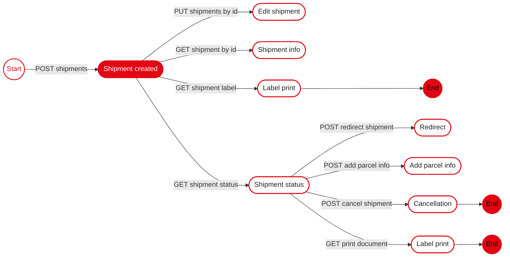

> For the complete documentation index, see [llms.txt](https://api-portal.novapost.com/llms.txt). Markdown versions of documentation pages are available by appending `.md` to page URLs; this page is available as [Markdown](https://api-portal.novapost.com/methods/methods/shipments/create-shipments/domestic-shipments-within-ukraine.md).

# Domestic shipments within Ukraine

This page describes the process of creating shipments within Ukraine.

<details>

<summary>Shipment API Interaction Flow</summary>



</details>

<details>

<summary>Schema (Object)</summary>

<table data-search="false"><thead><tr><th width="127">Field</th><th width="91" align="center">Type</th><th width="108" align="center">Required</th><th>Description</th></tr></thead><tbody><tr><td><strong>status</strong></td><td align="center">enum</td><td align="center">yes</td><td><p>Signifies the current status of the transportation document, tracking its progress through the shipping lifecycle. Statuses detail each critical phase:</p><ul><li><code>Draft</code>: The document is in its preliminary stage, not yet finalized.</li><li><code>Accepted</code>: Reviewed and accepted, the document is ready for the next steps.</li><li><code>Issued</code>: The document has been completed and is ready for shipping.</li><li><code>ReadyToShip</code>: Indicates that the shipment is prepared for transport following the creation of the express waybill. Only this value can be specified when creating a shipment.</li><li><code>Deleted</code>: The document has been deleted from the system.</li><li><code>Returned</code>: The shipment has been returned to its sender.</li><li><code>Utilized</code>: Indicates that the physical goods associated with the transportation document have been disposed of or destroyed and the document is closed.</li></ul><p>Allowed: <code>ReadyToShip</code></p></td></tr><tr><td><strong>clientOrder</strong></td><td align="center">string</td><td align="center">yes</td><td><p>Represents all potential order identifiers associated with the shipment. These identifiers are set by the customer for internal tracking purposes and are crucial for tracking the shipment throughout its journey. All entered values can be tracked in the shipment's tracking system.</p><p>Constraints: Max 50 chars</p></td></tr><tr><td><strong>note</strong></td><td align="center">string</td><td align="center">yes</td><td><p>Any additional information or special instructions that pertain to the order can be included here. This could encompass delivery instructions, special handling requests, or other pertinent details that facilitate the handling and processing of the shipment.</p><p>Constraints: Max 255 chars</p></td></tr><tr><td><strong>deliveryType</strong></td><td align="center">string</td><td align="center">no</td><td><p>Defines the tariff type to be applied to the shipment during creation or update.</p><ul><li><code>standard</code>: Standard international delivery tariff.</li><li><code>economy</code>: Economy international delivery tariff.</li><li><code>express</code>: Express international delivery tariff.</li></ul><p>If the field is not provided, the tariff type is determined automatically according to current business rules, and the existing shipment creation behaviour remains unchanged.</p></td></tr><tr><td><strong>payerType</strong></td><td align="center">enum</td><td align="center">yes</td><td><p>Identifies who is responsible for the payment of delivery services. The payer type determines which party bears the cost:</p><ul><li><code>Sender</code>: The party sending the goods pays for the delivery.</li><li><code>Recipient</code>: The party receiving the goods is responsible for the delivery cost.</li><li><code>ThirdPerson</code>: A third party, not the sender or recipient, pays for the delivery services. When selecting <code>ThirdPerson</code>, the field <code>payerContractNumber</code> must be populated with the contract number of the paying party. For more detailed information, refer to the article on <a href="https://api-portal.novapost.com/en/api-methods/payment/">Payment for Delivery Services via Nova Post API</a>. This field is also referenced when generating an invoice.</li></ul><p>Allowed: <code>Sender</code> | <code>Recipient</code> | <code>ThirdPerson</code></p></td></tr><tr><td><strong>payerContractNumber</strong></td><td align="center">string┃null</td><td align="center">yes</td><td><p>This field is required in the following cases:</p><ul><li>When the <code>payerType</code> is set to <code>ThirdPerson</code>. It must contain the payer's contract number. For clients from Ukraine, it is also acceptable to provide the tax identification number (EDRPOU) instead of the contract number.</li><li>When the <code>payerType</code> is set to <code>Sender</code> or <code>Recipient</code> and a non-cash payment method is used.</li></ul><p>If this field is not provided in the cases described above, the payment method will automatically default to cash.</p><p>Ensure that the provided information is accurate, as it is essential for correct payment processing.</p><p>For more detailed information, refer to the article on <a href="https://api-portal.novapost.com/en/api-methods/payment/">Payment for Delivery Services via Nova Post API</a>.</p><p>Constraints: 2 to 20 chars</p></td></tr><tr><td><strong>services</strong></td><td align="center">array</td><td align="center">no</td><td>Contains information about additional services for the shipment.</td></tr><tr><td>services.<strong>shipmentParcelRowNumber</strong></td><td align="center">integer</td><td align="center">yes</td><td><p>Specifies the row number of the parcel to which the service is applied. The value must correspond to the <code>rowNumber</code> of an existing parcel in the <code>parcels</code> array.</p><p>For services applied to the <strong>entire shipment</strong> (for example, <code>ExpBackwardGoods</code>), this field must be set to <code>null</code>.</p></td></tr><tr><td>services.<strong>serviceCode</strong></td><td align="center">string</td><td align="center">yes</td><td><p>The code indicating the service.</p><p><strong>A list of available codes and descriptions of their meanings:</strong></p><ul><li><code>COD</code> — The Cash on Delivery (COD) service allows the recipient to pay for the goods directly upon receiving them, without the need for prepayment. The sender can add this service to the shipment, and the recipient has the option to pay for the goods upon delivery and inspect them before making the payment, subject to payment method restrictions established for specific countries. </li></ul><p>🔸<strong>The COD service is planned to expand to other countries and delivery directions in the future, both for international shipments and within European countries.</strong></p><ul><li><code>ExpBackwardGoods</code> — Enables return delivery option for parent shipment</li><li><code>ExpBackwardCreditDoc</code> — Enables return delivery of signed documents for domestic document shipments within Moldova. The service is available only for legal entities and only for shipments with the <strong>Documents</strong> type. The return shipment is created as a separate document delivery (by courier or operator), and the payer is always the Recipient under a non-cash contract. Not available for Parcel Locker and PUDO service channels. In the first iteration, the service is enabled only for selected legal entities.</li></ul><p>🔹<strong>This field is required for the</strong> <code>services</code> <strong>group.</strong></p></td></tr><tr><td>services.<strong>serviceName</strong></td><td align="center">string</td><td align="center">yes</td><td><p>Name of the service.</p><p>Allowed values include:</p><ul><li><code>PaymentControl</code> — Payment control service.</li><li><code>MoneyTransfer</code> — Money transfer service.</li><li>Other service types available within the <code>services</code> group.</li></ul><p>🔹<strong>This field is required within the</strong> <code>services</code> <strong>group.</strong></p></td></tr><tr><td>services.<strong>serviceId</strong></td><td align="center">string</td><td align="center">yes</td><td><p>Unique identifier (reference ID) of the selected service.</p><p>This value must correspond to the service reference returned by the system. When creating or updating a shipment, the exact <code>serviceId</code> provided in the service reference response must be copied and used without modification.</p><p>🔹<strong>This field is required within the</strong> <code>services</code> <strong>group.</strong></p></td></tr><tr><td>services.<strong>amount</strong></td><td align="center">number</td><td align="center">yes</td><td><p>The total amount the recipient must pay under the COD service.</p><p>🔹<strong>This field is required for the</strong> <code>services</code> <strong>group.</strong></p></td></tr><tr><td>services.<strong>contractNumber</strong></td><td align="center">string┃null</td><td align="center">yes</td><td><p>Contract number of the payer responsible for the selected service. This parameter is used to identify the contractual agreement under which the service is paid.</p><p>The field is required when the service payer is a <strong>third party</strong> or when non-cash payment terms are applied. If not provided, the payment may be processed according to default billing rules.</p></td></tr><tr><td>services.<strong>payerType</strong></td><td align="center">string</td><td align="center">yes</td><td><p>Determines who is responsible for paying for the service. The payer type determines which party bears the costs:</p><ul><li><code>Recipient</code> — The only allowed value for the COD service.</li><li><code>Sender</code>, <code>Recipient</code> — Allowed payer values for the ExpBackwardGoods service.</li><li><code>Sender</code>, <code>Recipient</code>, <code>ThirdPerson</code> — Allowed payer values for the BackwardDelGoods service.</li></ul><p><strong>🔻This field is required</strong></p></td></tr><tr><td>services.<strong>additionalParameters</strong></td><td align="center">string</td><td align="center">yes</td><td>Additional parameters for the service.</td></tr><tr><td>services.additionalParameters.<strong>cod</strong></td><td align="center">string</td><td align="center">yes</td><td><p>Additional parameters for configuring COD.</p><p>🔹<strong>These parameters are mandatory and required only for the COD service</strong></p></td></tr><tr><td>services.additionalParameters.cod.<strong>bankAccount</strong></td><td align="center">object</td><td align="center">no</td><td>Information describing the bank account details to which the funds will be transferred. Includes the transfer amount, transaction currency, account identifiers, and the party responsible for paying the service fee.</td></tr><tr><td>services.additionalParameters.cod.bankAccount.<strong>amount</strong></td><td align="center">number</td><td align="center">yes</td><td><p>The amount that will be transferred to the sender’s account after payment. Specifies the amount the recipient must pay upon receipt. Automatic currency conversion is possible depending on the sender's or recipient's country.</p><p>🔹<strong>This field is required for the</strong> <code>services.additionalParameters.cod.bankAccount</code> <strong>field group.</strong></p></td></tr><tr><td>services.additionalParameters.cod.bankAccount.<strong>currencyCode</strong></td><td align="center">string</td><td align="center">yes</td><td><p>The currency for the transaction, defined by the sender’s contract. Specified according to the ISO 4217 standard.</p><p>🔸<strong>By default, the currency of the sender’s country is used, but it is possible to set the currency manually (Feature under development).</strong></p><p>Pattern: ^[A-Z]{3}$</p></td></tr><tr><td>services.additionalParameters.cod.bankAccount.<strong>bankAccountId</strong></td><td align="center">string</td><td align="center">yes</td><td><p>Tax identification number of an individual or a legal entity, used for its unique identification in the system and for verifying the existence of an active contract and the availability of financial services. The same as the value passed in the <code>companyTin</code> field.</p><p>🔹<strong>This field is required for the</strong> <code>services.additionalParameters.cod.bankAccount</code> <strong>field group.</strong></p><p>🔸<strong>Must contain the tax identification number or equivalent identifier (EDRPOU, TIN, NIP).</strong></p></td></tr><tr><td>services.additionalParameters.cod.bankAccount.<strong>bankAccountName</strong></td><td align="center">string</td><td align="center">yes</td><td><p>IBAN</p><p>🔹<strong>This field is required for the</strong> <code>services.additionalParameters.cod.bankAccount</code> <strong>field group.</strong></p><p>🔸<strong>Must contain the full account number in IBAN format.</strong></p></td></tr><tr><td>services.additionalParameters.cod.bankAccount.<strong>description</strong></td><td align="center">string</td><td align="center">yes</td><td>Additional description of the payment details.</td></tr><tr><td>services.additionalParameters.cod.bankAccount.<strong>commissionPayer</strong></td><td align="center">string</td><td align="center">yes</td><td><p>Specifies the party responsible for paying the commission:</p><ul><li><code>Recipient</code></li><li><code>Sender</code></li></ul><p>🔹<strong>This field is required for the</strong> <code>services.additionalParameters.cod.bankAccount</code> <strong>field group.</strong></p></td></tr><tr><td>services.additionalParameters.<strong>backwardDelivery</strong></td><td align="center">object</td><td align="center">yes</td><td><p>Additional parameters for configuring return delivery.</p><p>🔹<strong>These parameters are mandatory and required only for the ExpBackwardGoods service</strong></p></td></tr><tr><td>services.additionalParameters.backwardDelivery.<strong>description</strong></td><td align="center">string</td><td align="center">no</td><td>Description of the goods to be returned. This value is used for informational and operational purposes during the return delivery process.</td></tr><tr><td><strong>invoice</strong></td><td align="center">object</td><td align="center">no</td><td><p>This object presents the necessary data for customs authorities to process the consignment efficiently, including the assessment of duties and taxes, and to confirm adherence to import/export regulations. The structured format of the invoice ensures that all pertinent information is easily accessible and clear, facilitating a smoother transit across borders.</p><p>Updated logic for invoice value handling. Clients must now send only two parameters in the invoice object:</p><ul><li><code>cost</code> — total declared value of the invoice</li><li><code>currency</code> — currency code of the invoice</li></ul><p><strong>🔸It encapsulates the invoice details, which are required for international shipments undergoing customs clearance.</strong></p></td></tr><tr><td>invoice.<strong>customerNumber</strong></td><td align="center">string┃null</td><td align="center">yes</td><td><p>Unique identifier/number of the invoice accompanying the goods in the shipment, generated directly by the client. It is used for customs processing (export and import clearance) because it ensures a clear link between the goods in the shipment and their accompanying documentation, including value, origin, and other necessary information for customs clearance.</p><p>If a client invoice exists in the shipment but its information is missing—specifically, its number—the shipment processing in the information system will be halted, the customs clearance period will be extended, and in the worst case, customs authorities may refuse clearance and initiate a return to the country of export.</p><p>Constraints: Max 50 chars</p></td></tr><tr><td>invoice.<strong>customerCreatedAt</strong></td><td align="center">string</td><td align="center">yes</td><td><p>You must provide the date specified in the invoice accompanying the shipment. If the date is not present in the client document, the shipment creation date may be used.</p><p><strong>🔹This field is required if the</strong> <code>invoice.customerNumber</code> <strong>field is filled in.</strong></p><p>Pattern: ^20[0-9]{2}-[0-9]{2}-[0-9]{2}T[0-9]{2}:[0-9]{2}:[0-9]{2}.[0-9]{6}Z$</p></td></tr><tr><td>invoice.<strong>type</strong></td><td align="center">string</td><td align="center">yes</td><td><p>Type of client invoice accompanying the shipment and used for customs declaration. This field must reflect the actual type of document enclosed in the parcel. Available values:</p><ul><li><code>Invoice</code> — commercial invoice for shipments of a commercial nature</li><li><code>ProformaInvoice</code> — proforma invoice for shipments of a non-commercial nature</li></ul><p><strong>🔹This field is required if the</strong> <code>invoice.customerNumber</code> <strong>field is filled in.</strong></p><p>Possible values: <code>Invoice</code> | <code>ProformaInvoice</code></p></td></tr><tr><td>invoice.<strong>incoterm</strong></td><td align="center">string</td><td align="center">yes</td><td><p>Specifies the trade terms for the shipping agreement between the buyer and seller, based on selected standards from the Incoterms® rules. These terms define the allocation of shipping costs, insurance, customs duties, and the distribution of risk. Only a limited subset of Incoterms® is available for use:</p><ul><li><code>DAP</code> (Delivered at Place) - The recipient is responsible for import customs clearance, duties, and taxes.</li><li><code>DDP</code> (Delivered Duty Paid) - The sender is responsible for import customs clearance and for paying all applicable duties and taxes.</li></ul><p><strong>🔹This field is required for shipments crossing the EU border or going outside the EU.</strong></p><p>Possible values: <code>DAP</code> | <code>DDP</code></p></td></tr><tr><td>invoice.<strong>exportReason</strong></td><td align="center">string</td><td align="center">yes</td><td><p>Specifies the general reason for exporting items, which is required for customs and other regulatory bodies. This classification helps in understanding the type of shipment without getting into specifics. It's used to categorize shipments at a high level for smoother processing through customs. The available options are:</p><ul><li><code>ForPersonalPurposes</code>: Items are for personal use or gifts.</li><li><code>Selling</code>: Items are meant for sale.</li><li><code>Repair</code>: Items being sent for repair.</li><li><code>Return</code>: Items are being returned to the sender or manufacturer.</li><li><code>Other</code>: Any reason not covered by the other options.</li></ul><p><strong>🔹This field is required for shipments crossing the EU border or going outside the EU.</strong></p><p>Possible values: <code>ForPersonalPurposes</code>,<code>Selling</code>,<code>Repair</code>,<code>Return</code>,<code>Other</code></p></td></tr><tr><td>invoice.<strong>cost</strong></td><td align="center">number</td><td align="center">yes</td><td><p>Total declared invoice value in the original currency, which must equal the sum of all invoice items calculated as <strong>(amount × cost)</strong> for each item. Used for customs and shipment declarations.</p><p><strong>🔸If the provided <code>cost</code> value does not equal the sum of the <code>cost</code> values in the</strong> <code>items</code> <strong>array, it will be automatically recalculated by the system on our side.</strong></p><p><strong>🔸Values are validated for decimal precision, and digits beyond two decimal places are ignored.</strong></p><p><strong>🔹This field is required for shipments crossing the EU border or going outside the EU.</strong></p><p>Constraints: Min 0┃Max 9999999.99</p></td></tr><tr><td>invoice.<strong>currency</strong></td><td align="center">string</td><td align="center">yes</td><td><p>ISO 4217 currency code of the invoice. All items in the invoice must use the same currency.</p><p><strong>🔹This field is required for shipments crossing the EU border or going outside the EU.</strong></p><p>Pattern: ^[A-Z]{3}$</p></td></tr><tr><td>invoice.<strong>payerFeesCustoms</strong></td><td align="center">string</td><td align="center">yes</td><td><p>Specifies who is responsible for paying for customs services. The parameter determines which party bears the costs:</p><ul><li><code>Sender</code>: The party sending the goods pays for the customs duties.</li><li><code>Recipient</code>: The party receiving the goods is responsible for the customs duties costs.</li><li><code>ThirdPerson</code>: A third party can only pay for customs services if this is permitted and the payer for delivery services is also a third party.</li></ul><p>The default value is <strong>"Recipient"</strong>.<br>This value will also be applied automatically if the parcel exceeds the maximum allowed value (in the recipient country’s currency) for which the sender is permitted to pay customs duties.</p><p><strong>🔹This parameter is required and valid only for the UA-EU direction.</strong></p><p>Possible values: <code>Sender</code> | <code>Recipient</code> | <code>ThirdPerson</code></p></td></tr><tr><td>invoice.<strong>items</strong></td><td align="center">object</td><td align="center">yes</td><td><p>A detailed list of goods being shipped, including required descriptions and values, essential for customs declarations and assessing duties.</p><p><strong>Logic:</strong> If the items block is provided, the system checks whether the total sum of all (<code>items.cost</code> × <code>items.amount</code>) matches the <code>invoice.cost</code> value. If not — the system updates <code>invoice.cost</code> to equal the sum of all items.</p><p><strong>🔸It is required to provide this information for each individual good in the shipment in the form of an array.</strong></p></td></tr><tr><td>invoice.items.<strong>customerId</strong></td><td align="center">string</td><td align="center">no</td><td><p>Client item identifier.</p><p><strong>🔹This field is optional.</strong></p></td></tr><tr><td>invoice.items.<strong>hsCode</strong></td><td align="center">string | null</td><td align="center">yes</td><td><p>The Harmonized System code for each item, a standardized numerical method of classifying traded products. This field is required for international shipments that pass through customs clearance. You can obtain the valid <code>hsCode</code> from the Cargo Classifiers (UKT ZED) dictionary. Validation rules:</p><ul><li><p><strong>If the sender or recipient country is Moldova (MD) or Canada (CA):</strong></p><ul><li>The <code>hsCode</code> must consist of exactly 10 numeric characters.</li><li>If the input is longer than 10 digits, it will be <strong>truncated</strong> on the right.</li><li>If it contains fewer than 10 digits - validation error.</li></ul></li><li><p><strong>For all other countries:</strong></p><ul><li>The <code>hsCode</code> must contain <strong>between 8 and 10 numeric characters</strong> (inclusive).</li><li>If fewer than 8 digits – validation error.</li></ul></li><li><strong>All non-digit characters will be stripped automatically before validation.</strong></li><li><p><strong>If the value of the <code>hsCode</code> field is <code>210690</code> or <code>630900</code>, the following conditions must be met:</strong></p><ul><li>The <code>measurementCode</code> must be set to <code>kg</code>.</li><li>Each item with this <code>hsCode</code> must be unique — the invoice must not contain more than one item with code <code>210690</code> or <code>630900</code>.</li><li>The amount value must not exceed 10.</li></ul></li></ul><p><strong>🔹This field is required for shipments crossing the EU border or going outside the EU.</strong></p><p>Constraints: Max 255 chars</p></td></tr><tr><td>invoice.items.<strong>name</strong></td><td align="center">string</td><td align="center">yes</td><td><p>Represents the item's name in the local language, offering an accurate description for customs and logistical planning. The name should correspond with terminologies found in the Cargo Classifiers (UKT ZED) dictionary, ensuring compliance with standard classification codes. This detailed description aids in precise item identification during the customs clearance process. This field supports Unicode encoding, permitting the inclusion of special characters and symbols using the \uXXXX format. This capability allows for precise representation of item names in languages that incorporate non-Latin characters, enhancing clarity and understanding across diverse regulatory environments.</p><p><strong>🔹This field is required for shipments crossing the EU border or going outside the EU.</strong></p><p>Constraints: Max 512 chars</p></td></tr><tr><td>invoice.items.<strong>nameEng</strong></td><td align="center">string</td><td align="center">yes</td><td><p>Specifies the item's name in English, critical for ensuring that the product is identifiable and understandable across international trade and logistics channels. The English name simplifies communication and documentation processes when dealing with international partners and authorities, aiding in the seamless facilitation of global shipments. Similar to the <code>name</code> field, this parameter also supports Unicode encoding. Using the \uXXXX format, it accommodates the accurate rendering of any special characters necessary for the correct representation of the item's name in English.</p><p><strong>🔹This field is required for shipments crossing the EU border or going outside the EU.</strong></p><p>Constraints: Max 512 chars</p></td></tr><tr><td>invoice.items.<strong>material</strong></td><td align="center">string</td><td align="center">no</td><td><p>The primary material from which the item is made, important for customs declarations and potential restrictions.</p><p><strong>🔸If this field is not provided, the default value will be applied.</strong></p><p>Constraints: Max 50 chars</p></td></tr><tr><td>invoice.items.<strong>materialEng</strong></td><td align="center">string</td><td align="center">no</td><td><p>The description of the item's material in English, aiding in the universal understanding of the product's composition.</p><p><strong>🔸If this field is not provided, the default value will be applied.</strong></p><p>Constraints: Max 255 chars</p></td></tr><tr><td>invoice.items.<strong>madeInCountryCode</strong></td><td align="center">string | null</td><td align="center">no</td><td><p>The ISO 3166-1 alpha-2 code indicating the country of manufacture, essential for determining import duties and compliance with trade agreements.</p><p><strong>🔸This field is not required; however, shipments with this field filled are given priority during customs clearance.</strong></p><p>Pattern: ^[A-Z]{2}$</p></td></tr><tr><td>invoice.items.<strong>producerAndModel</strong></td><td align="center">string | null</td><td align="center">no</td><td><p>The parameter represents the manufacturer and model of the device when creating a shipment. Both values are included in a single parameter. This parameter is mandatory for the following categories:</p><ul><li>Electrical appliances</li><li>Laptops</li><li>Phones</li><li>Large and small household appliances</li><li>Other similar items</li></ul><p><strong>🔸This field is not required; however, shipments with this field filled are given priority during customs clearance.</strong></p><p>Constraints: Max 255 chars</p></td></tr><tr><td>invoice.items.<strong>actualWeight</strong></td><td align="center">integer | null</td><td align="center">yes</td><td><p>Actual total weight of all units of the item in grams (g).</p><p>Supported precision: 10 grams (0.01 kg). Values not divisible by 10 g are rounded down to the nearest lower multiple of 10 g.</p><p><strong>🔸This field is mandatory when the</strong> <code>invoice.items</code> <strong>array is present in the request.</strong><br>The system validates that the sum of <code>actualWeight</code> values across <strong>all invoice items</strong> matches the <strong>total shipment weight</strong> (sum of <code>parcels[].actualWeight</code>).</p><p>⚠️IMPORTANT: Ensure that all invoice item weights are correctly rounded and that their total weight exactly matches the shipment weight to avoid validation errors.</p><p>Constraints: Min 1┃Max 2147483647</p></td></tr><tr><td>invoice.items.<strong>measurementCode</strong></td><td align="center">string</td><td align="center">yes</td><td><p>The unit of measurement for the item quantity, such as pieces, kilograms, meters, etc., standardizing the way quantities are reported.</p><p><strong>🔹This field is required for shipments crossing the EU border or going outside the EU.</strong></p><p>Constraints: Max 255 chars</p></td></tr><tr><td>invoice.items.<strong>amount</strong></td><td align="center">number</td><td align="center">yes</td><td><p>The quantity of the item being shipped, necessary for inventory and customs documentation. Value in the units of measurement corresponding to the field <code>measurementCode</code>.</p><p><strong>🔹This field is required for shipments crossing the EU border or going outside the EU.</strong></p><p>Constraints: Min 0┃Max 9999999.99</p></td></tr><tr><td>invoice.items.<strong>cost</strong></td><td align="center">number</td><td align="center">yes</td><td><p>The value per single unit of the item in the sender's currency, important for insurance and customs valuation.</p><p><strong>🔸Values are validated for decimal precision, and digits beyond two decimal places are ignored.</strong></p><p><strong>🔹This field is required for shipments crossing the EU border or going outside the EU.</strong></p><p>Constraints: Min 0┃Max 9999999.99</p></td></tr><tr><td><strong>parcels</strong></td><td align="center">object</td><td align="center">yes</td><td><p>Parcels` description block. Array contains objects, each object responsible for information about parcel.</p><p><strong>🔻All fields in this array must be filled.</strong></p></td></tr><tr><td>parcels.<strong>cargoCategory</strong></td><td align="center">string</td><td align="center">no</td><td><p>Specifies the type of the shipment, helping to categorize the goods for logistics and customs processing. The category impacts how the shipment is handled, its shipping cost, and the required documentation. Available categories are:</p><ul><li><code>parcel</code>: Small to medium-sized packages, typically for consumer goods and retail items.</li><li><code>documents</code>: Postal shipments containing documents such as letters, contracts, and official papers. This category is specifically for items that weigh no more than 1 kg and have dimensions not exceeding 35 cm in length, 25 cm in width, and 2 cm in height.</li><li><p><code>pallet</code>: Type of cargo formed as a pallet shipment with fixed dimensions and weight limits, available in the Business Cabinet of Europe for legal entities:</p><ul><li>Up to 250 kg, area ~0.48 m², dimensions 80 × 60 × 170 cm</li><li>Up to 500 kg, area ~0.96 m², dimensions 120 × 80 × 170 cm</li><li>Up to 750 kg, area ~1.2 m², dimensions 120 × 100 × 170 cm</li><li>Up to 1000 kg, area ~1.2 m², dimensions 120 × 100 × 170 cm</li></ul></li></ul><p>Possible values: <code>parcel</code> | <code>documents</code> | <code>pallet</code></p></td></tr><tr><td>parcels.<strong>parcelDescription</strong></td><td align="center">string</td><td align="center">no</td><td><p>This field requires a concise description of the contents within the shipment, providing essential information on the nature of the items enclosed. This description aids in the logistics process, offering a clear understanding of the package contents for transportation planning and customs clearance. The summary should include details like the type of items, their purpose, and any other relevant information that describes the contents. It’s crucial for ensuring that the shipment complies with shipping regulations and facilitates smooth customs processing. Additionally, this field supports data in Unicode encoding, allowing for the inclusion of special characters and symbols using the \uXXXX format. This feature is particularly useful for languages that use non-Latin characters, ensuring accurate representation of item descriptions across diverse linguistic contexts.</p><p>Constraints: Max 255 chars</p></td></tr><tr><td>parcels.<strong>insuranceCost</strong></td><td align="center">number</td><td align="center">yes</td><td><p>Represents the declared value of the shipment for insurance coverage. This value indicates the maximum compensation amount in the event of damage or loss during transit. It is important to accurately declare this value to match the actual worth of the shipment contents, as underdeclaring can result in insufficient compensation.</p><p><strong>Currency handling:</strong></p><ul><li>If <code>insuranceCurrencyCode</code> is <strong>not provided</strong>, the value must be specified in the <strong>currency of the sender's country</strong>.</li><li>If <code>insuranceCurrencyCode</code> <strong>is provided</strong>, the value can be specified in any supported currency (ISO 4217). The system will automatically convert it to the sender's country currency before further processing.</li></ul><p>🔸<strong>When <code>insuranceCurrencyCode</code> is used, all parcels must specify the same currency code. Mixed or partially filled currency values will result in a validation error.</strong></p><p><strong>The value must always be greater than 0, regardless of the shipment direction.</strong>"</p><p>Example: <code>1.5</code></p></td></tr><tr><td>parcels.<strong>insuranceCurrencyCode</strong></td><td align="center">string</td><td align="center">no</td><td><p>ISO 4217 currency code for the declared insurance value (<code>insuranceCost</code>).</p><ul><li>When provided, the system converts <code>insuranceCost</code> to the sender's country currency automatically.</li><li>If used, all parcels must have the same <code>insuranceCurrencyCode</code>.</li></ul><p>🔹<strong>This field is optional.</strong>"</p><p>Pattern: ^[A-Z]{3}$</p></td></tr><tr><td>parcels.<strong>rowNumber</strong></td><td align="center">integer</td><td align="center">yes</td><td><p>Sequential identifier for each parcel within a shipment, used to organize and track individual packages, especially when multiple items are involved. If the shipment contains only one package, the value should be 1.</p><p>Constraints: Min 1</p></td></tr><tr><td>parcels.<strong>width</strong></td><td align="center">integer</td><td align="center">yes</td><td><p>The parcel's width measured in millimeters, used alongside length and height to compute the total volume for logistical planning.</p><p>Constraints: Min 1</p></td></tr><tr><td>parcels.<strong>length</strong></td><td align="center">integer</td><td align="center">yes</td><td><p>The parcel's length measured in millimeters, used alongside height and width to compute the total volume for logistical planning.</p><p>Constraints: Min 1</p></td></tr><tr><td>parcels.<strong>height</strong></td><td align="center">integer</td><td align="center">yes</td><td><p>The parcel's height measured in millimeters, used alongside length and width to compute the total volume for logistical planning.</p><p>Constraints: Min 1</p></td></tr><tr><td>parcels.<strong>actualWeight</strong></td><td align="center">integer</td><td align="center">yes</td><td><p>Actual item weight in grams (g).</p><p>Supported precision: 10 grams (0.01 kg). Values not divisible by 10 g are rounded down to the nearest lower multiple of 10 g.</p><p><strong>🔸This field is mandatory when the</strong> <code>invoice.items</code> <strong>array is present in the request.</strong><br>The system validates that the sum of <code>actualWeight</code> values across <strong>all invoice items</strong> matches the <strong>total shipment weight</strong> (sum of <code>parcels[].actualWeight</code>).</p><p>⚠️IMPORTANT: Ensure that all invoice item weights are correctly rounded and that their total weight exactly matches the shipment weight to avoid validation errors.</p><p>Constraints: Min 1┃Max 2147483647</p></td></tr><tr><td><strong>sender</strong></td><td align="center">object</td><td align="center">yes</td><td><p>Information about the party sending the shipment, including details about an individual or organization responsible for the dispatch.</p><p><strong>🔻This array of fields is required</strong></p></td></tr><tr><td>sender.<strong>companyTin</strong></td><td align="center">string</td><td align="center">yes</td><td><p>The tax identification number or equivalent identifier (EDRPOU, TIN, NIP, IČO - for Slovakia) of a legal entity.</p><p><strong>🔸The fields are required for a legal entity. If they are not filled in, the sender will be considered an individual</strong></p><p>Constraints: Max 20 chars</p></td></tr><tr><td>sender.<strong>companyName</strong></td><td align="center">string | null</td><td align="center">yes</td><td><p>The official name of the sender's company. This field is used when the sender is a business entity, helping to identify the sending organization in documentation and records.</p><p>Constraints: Max 100 chars</p></td></tr><tr><td>sender.<strong>eoriCode</strong></td><td align="center">string | null</td><td align="center">yes</td><td><p>The EORI code (Economic Operators Registration and Identification number) is used by the European Union to identify economic operators engaged in international trade. The sender's EORI code should be included in the invoice to ensure correct customs clearance and taxation when shipping goods to EU countries. The code is not mandatory but strongly recommended for international shipments to the EU, as it facilitates customs processing and helps avoid delays.</p><p>Constraints: 3 to 17 chars</p></td></tr><tr><td>sender.<strong>phone</strong></td><td align="center">string</td><td align="center">yes</td><td><p>The contact phone number of the sender or the sender’s company representative. It is required for shipment-related communication, including pickup coordination and issue resolution. </p><p><strong>Format:</strong> The phone number must be provided in <strong>international format</strong> according to the <strong>E.164</strong> standard. </p><p>Example: 380XXXXXXXXX, 491234567890, 371XXXXXXXX </p><p><strong>Restrictions:</strong></p><ul><li>The sender's phone number must be valid and reachable in case of delivery issues.</li><li>If the number is submitted in a local (non-international) format, the system will attempt to <strong>normalize</strong> it, but such logic is limited and may not support all variations across countries. We strongly recommend implementing <strong>front-end validation</strong> to ensure numbers are entered in the correct international format.</li></ul><p><strong>🔻This field is required</strong></p></td></tr><tr><td>sender.<strong>email</strong></td><td align="center">string</td><td align="center">yes</td><td><p>Email address of the sender, providing an electronic means of contact for updates, inquiries, and important notifications about the shipment.</p><p><strong>🔹This field is required for shipments crossing the EU border or going outside the EU.</strong></p></td></tr><tr><td>sender.<strong>name</strong></td><td align="center">string</td><td align="center">yes</td><td><p>The full name of the individual sender or the primary contact person for a company sender. This name is used in all correspondences and documents related to the shipment.</p><p><strong>🔸Important for EU → UA international shipments:</strong><br>The sender name <strong>must be provided using Latin characters only</strong>. Use of Cyrillic characters (including Ukrainian letters) is <strong>not allowed</strong> and will result in validation or processing errors on the Last Mile partner side.</p><p><strong>🔻This field is required</strong></p><p>Constraints: Max 100 chars</p></td></tr><tr><td>sender.<strong>ioss</strong></td><td align="center">string</td><td align="center">no</td><td><p>The IOSS (Import One-Stop Shop) number is an optional input used to facilitate the VAT declaration process for shipments from non-EU countries with a declared value of up to EUR 150. It is utilized by shippers using the IOSS process to simplify customs procedures for deliveries to private customers in the EU. This field is available for shipments where the sender's country is outside the EU and the destination is within the EU.</p><p>Constraints: Max 12 chars </p><p>Pattern: /^[a-zA-Z0-9]*$/u</p></td></tr><tr><td>sender.<strong>countryCode</strong></td><td align="center">string</td><td align="center">yes</td><td><p>A two-letter code representing the sender's country, following the ISO 3166-1 Alpha-2 standard, indicating the country of origin for the shipment.</p><p><strong>🔻This field is required</strong></p><p>Pattern: ^[A-Z]{2}$</p></td></tr><tr><td>sender.<strong>divisionNumber</strong></td><td align="center">string | null</td><td align="center">yes</td><td><p>This field is mandatory for parcels that are dispatched from a post office division or parcel locker, requiring the unique identifier of the dispatch location to be specified.</p><p><strong>🔹This field is required if both the</strong> <code>sender.addressParts</code> <strong>group and the</strong> <code>sender.divisionID</code> <strong>field are missing or empty</strong></p><p>Example: <code>32521/1</code></p></td></tr><tr><td>sender.<strong>divisionID</strong></td><td align="center">integer | null</td><td align="center">yes</td><td><p>Division ID for specific branch identification.</p><p><strong>🔹This field is required if both the</strong> <code>sender.addressParts</code> <strong>group and the</strong> <code>sender.divisionNumber</code> <strong>field are missing or empty</strong></p><p>Constraints: Min 1</p></td></tr><tr><td>sender.<strong>addressParts</strong></td><td align="center">object</td><td align="center">yes</td><td>This array of fields is required when shipping directly from an address, detailing the specific components of the location from which the parcel is dispatched. It includes detailed address information, ensuring the accurate identification of the pickup location.</td></tr><tr><td>sender.addressParts.<strong>city</strong></td><td align="center">string</td><td align="center">yes</td><td><p>The name of the city from which the shipment is dispatched. It helps pinpoint the exact urban location for pickup or shipping.</p><p><strong>🔹This field is required if</strong> <code>sender.divisionNumber</code> <strong>and</strong> <code>sender.divisionID</code> <strong>fields are missing or empty.</strong><br>🔸For shipments where the sender country is <strong>Moldova</strong> or <strong>Ukraine</strong>, the sender city is validated against internal settlement directories. If the settlement cannot be resolved due to an invalid or unmapped value, the shipment will not be created.</p><p>Constraints: Max 100 chars</p></td></tr><tr><td>sender.addressParts.<strong>region</strong></td><td align="center">string</td><td align="center">yes</td><td><p>Specifies the broader administrative area, like a state or province, encompassing the city, providing additional context for the shipment's origin.</p><p><strong>🔹This field is required for shipments when the sender or recipient country is the USA, Ireland, or Canada.</strong></p><p>Constraints: Max 100 chars</p></td></tr><tr><td>sender.addressParts.<strong>street</strong></td><td align="center">string</td><td align="center">yes</td><td><p>Identifies the specific street address for the sender's location, crucial for accurate pickup or delivery operations.</p><p><strong>🔹This field is required if</strong> <code>sender.divisionNumber</code> <strong>and</strong> <code>sender.divisionID</code> <strong>fields are missing or empty.</strong></p><p>Constraints: Max 100 chars</p></td></tr><tr><td>sender.addressParts.<strong>postCode</strong></td><td align="center">string</td><td align="center">yes</td><td><p>The postal or ZIP code corresponding to the sender's address. It's essential for sorting and routing the shipment efficiently.</p><p><strong>🔹This field is required if</strong> <code>sender.divisionNumber</code> <strong>and</strong> <code>sender.divisionID</code> <strong>fields are missing or empty.</strong></p><p>Constraints: Max 10 chars</p></td></tr><tr><td>sender.addressParts.<strong>building</strong></td><td align="center">string</td><td align="center">yes</td><td><p>The building number or name at the specified street address, pinpointing the precise location for shipment collection.</p><p><strong>🔹This field is required if</strong> <code>sender.divisionNumber</code> <strong>and</strong> <code>sender.divisionID</code> <strong>fields are missing or empty.</strong></p><p>Constraints: Max 100 chars</p></td></tr><tr><td>sender.addressParts.<strong>flat</strong></td><td align="center">string</td><td align="center">no</td><td><p>If applicable, the apartment or suite number within a building from which the shipment originates, ensuring pickup personnel can locate the sender's exact unit.</p><p>Constraints: Max 10 chars</p></td></tr><tr><td>sender.addressParts.<strong>block</strong></td><td align="center">string | null</td><td align="center">no</td><td><p>Indicates a specific block or section within a larger residential area or complex, if relevant, aiding in locating the sender's precise starting point for the shipment.</p><p>Constraints: Max 100 chars</p></td></tr><tr><td>sender.addressParts.<strong>note</strong></td><td align="center">string</td><td align="center">no</td><td><p>Allows for the inclusion of additional details or instructions about the sender's address that might facilitate the pickup process, such as gate codes, specific entry points, or preferred contact times.</p><p>Constraints: Max 100 chars</p></td></tr><tr><td><strong>recipient</strong></td><td align="center">object</td><td align="center">yes</td><td><p>Information about the party receiving the shipment, detailing either an individual or an organization responsible for receiving the dispatched goods.</p><p><strong>🔻This array of fields is required</strong></p></td></tr><tr><td>recipient.<strong>companyTin</strong></td><td align="center">string | null</td><td align="center">yes</td><td><p>The tax identification number or equivalent identifier (EDRPOU, TIN, NIP, IČO - for Slovakia) of a legal entity.</p><p><strong>🔸The fields are required for a legal entity. If they are not filled in, the recipient will be considered an individual</strong></p><p>Constraints: Max 20 chars</p></td></tr><tr><td>recipient.<strong>companyName</strong></td><td align="center">string | null</td><td align="center">yes</td><td><p>The formal name of the recipient's company. Utilize this field when the recipient is a business entity, aiding in the identification of the receiving organization in documents and records.</p><p>Constraints: Max 100 chars</p></td></tr><tr><td>recipient.<strong>eoriCode</strong></td><td align="center">string | null</td><td align="center">yes</td><td><p>The recipient's EORI code is important for customs clearance when shipping goods to European Union countries, especially when sending to legal entities. The code is not mandatory but recommended, as it helps ensure smooth customs clearance and minimizes the risk of delays. The requirement for the recipient eoriCode depends on the type of goods being shipped:</p><ol><li>Non-excise goods: The EORI code is not mandatory if non-excise goods are being shipped from Ukraine to a legal entity in Europe. If the recipient does not have an EORI code, one will be automatically assigned.</li><li>Excise goods: The EORI code is required for shipments of excise goods. The recipient must obtain an EORI code before the goods can be shipped.</li></ol><p>Constraints: 3 to 17 chars</p></td></tr><tr><td>recipient.<strong>phone</strong></td><td align="center">string</td><td align="center">yes</td><td><p>The contact phone number of the recipient or the recipient’s company representative. Used for delivery notifications and communication with the customer during shipment processing. </p><p><strong>Format:</strong> The phone number must be provided in <strong>international format</strong> according to the <strong>E.164</strong> standard. </p><p>Example: 380XXXXXXXXX, 491234567890, 371XXXXXXXX </p><p><strong>Restrictions:</strong></p><ul><li>For deliveries to Nova Post branches in Europe, Ukrainian mobile numbers are acceptable.</li><li>For deliveries to <strong>partner locations</strong> (such as InPost, GLS, Venipak, Cargus, etc.) and <strong>cross-border address deliveries</strong>, the phone number must belong to a mobile operator in the recipient's country. If the phone number is submitted in a local (non-international) format, the system will attempt to <strong>normalize</strong> it to the international format, but the internal algorithm does not cover all possible cases. If your system does not support front-end validation of phone numbers, we recommend informing us about failed phone number cases so we can assess potential improvements to the normalization logic.</li></ul><p><strong>🔻This field is required</strong></p></td></tr><tr><td>recipient.<strong>email</strong></td><td align="center">string</td><td align="center">yes</td><td><p>The email address of the recipient, serving as a digital contact point for shipment updates, inquiries, and essential notifications.</p><p><strong>🔹This field is required for shipments crossing the EU border or going outside the EU.</strong></p></td></tr><tr><td>recipient.<strong>name</strong></td><td align="center">string</td><td align="center">yes</td><td><p>The complete name of the individual recipient or the primary contact for a company recipient. This is the name used for all shipping-related correspondence and documentation.</p><p><strong>🔻This field is required</strong></p><p>Constraints: Max 100 chars</p></td></tr><tr><td>recipient.<strong>countryCode</strong></td><td align="center">string</td><td align="center">yes</td><td><p>A two-letter code that identifies the recipient's country, adhering to the ISO 3166-1 Alpha-2 standard, which specifies the shipment's destination country.</p><p><strong>🔻This field is required</strong></p><p>Pattern: ^[A-Z]{2}$</p></td></tr><tr><td>recipient.<strong>divisionNumber</strong></td><td align="center">string | null</td><td align="center">yes</td><td><p>This field is mandatory for parcels intended to be collected from a post office division or parcel locker, requiring the insertion of the unique identifier for the designated location.</p><p><strong>🔹This field is required if both the</strong> <code>recipient.addressParts</code> <strong>group and the</strong> <code>recipient.divisionID</code> <strong>field are missing or empty</strong></p><p>Example: <code>32521/1</code></p></td></tr><tr><td>recipient.<strong>divisionID</strong></td><td align="center">integer | null</td><td align="center">yes</td><td><p>Division ID for specific branch identification.</p><p><strong>🔹This field is required if both the</strong> <code>recipient.addressParts</code> <strong>group and the</strong> <code>recipient.divisionNumber</code> <strong>field are missing or empty</strong></p><p>Constraints: Min 1</p></td></tr><tr><td>recipient.<strong>addressParts</strong></td><td align="center">object</td><td align="center">yes</td><td><p>This array of fields is necessary when the shipment is directed to a specific address, outlining the precise location details to which the parcel is to be delivered. It encompasses comprehensive address information to ensure the exact identification of the delivery location.</p><p><strong>🔸The values in the nested address fields must not duplicate each other. Providing the same address information in multiple inner fields will result in an error.</strong></p></td></tr><tr><td>recipient.addressParts.<strong>city</strong></td><td align="center">string</td><td align="center">yes</td><td><p>The city to which the shipment is being delivered. This detail ensures the parcel is directed to the correct urban area for the recipient.</p><p><strong>🔹This field is required if</strong> <code>recipient.divisionNumber</code> <strong>and</strong> <code>recipient.divisionID</code> <strong>fields are missing or empty.</strong><br>🔸For shipments where the recipient country is <strong>Moldova</strong> or <strong>Ukraine</strong>, the recipient city is validated against internal settlement directories. If the settlement cannot be resolved due to an invalid or unmapped value, the request will be rejected with the error:<code>validation.condition.recipient_settlement_not_defined</code>.</p><p>Constraints: Max 100 chars</p></td></tr><tr><td>recipient.addressParts.<strong>region</strong></td><td align="center">string</td><td align="center">yes</td><td><p>Specifies the recipient's state or province within the destination country, crucial for accurate shipment routing and delivery. When sending to the USA, it's essential to include a two-letter state code, such as "WA" for Washington or "DC" for the District of Columbia, according to the ISO 3166-2:US standard.</p><p><strong>🔹This field is required for shipments when the sender or recipient country is the USA, Ireland, or Canada.</strong></p><p>Constraints: Max 100 chars</p></td></tr><tr><td>recipient.addressParts.<strong>street</strong></td><td align="center">string</td><td align="center">yes</td><td><p>The street name of the recipient's address, vital for pinpointing the exact delivery spot.</p><p><strong>🔹This field is required if</strong> <code>recipient.divisionNumber</code> <strong>and</strong> <code>recipient.divisionID</code> <strong>fields are missing or empty.</strong></p><p>Constraints: Max 100 chars</p></td></tr><tr><td>recipient.addressParts.<strong>postCode</strong></td><td align="center">string</td><td align="center">yes</td><td><p>The postal or ZIP code for the recipient's address, critical for the precise sorting and routing of the parcel to its final destination.</p><p><strong>🔹This field is required if</strong> <code>recipient.divisionNumber</code> <strong>and</strong> <code>recipient.divisionID</code> <strong>fields are missing or empty.</strong></p><p>Constraints: Max 10 chars</p></td></tr><tr><td>recipient.addressParts.<strong>building</strong></td><td align="center">string</td><td align="center">yes</td><td><p>Specifies the building number or name at the recipient's address, guiding the delivery to the exact building within a given street.</p><p><strong>🔹This field is required if</strong> <code>recipient.divisionNumber</code> <strong>and</strong> <code>recipient.divisionID</code> <strong>fields are missing or empty.</strong></p><p>Constraints: Max 100 chars</p></td></tr><tr><td>recipient.addressParts.<strong>flat</strong></td><td align="center">string</td><td align="center">no</td><td><p>The apartment or suite number, if the delivery is to a multi-unit building, ensuring the parcel reaches the specific unit of the recipient.</p><p>Constraints: Max 10 chars</p></td></tr><tr><td>recipient.addressParts.<strong>block</strong></td><td align="center">string | null</td><td align="center">no</td><td><p>Identifies a block or section within a larger complex or residential area for the recipient, useful in large housing developments to further narrow down the delivery point.</p><p>Constraints: Max 100 chars</p></td></tr><tr><td>recipient.addressParts.<strong>note</strong></td><td align="center">string</td><td align="center">no</td><td><p>The space for any additional recipient-related address instructions or details that might assist in the delivery process, such as security instructions, specific doors for delivery, or preferred delivery times.</p><p>Constraints: Max 100 chars</p></td></tr><tr><td>recipient.<strong>registrationAddressRecipient</strong></td><td align="center">object</td><td align="center">no</td><td>The registrationAddressRecipient object provides a detailed breakdown of the recipient's registered address and is required when shipping to countries with specific customs requirements, such as Germany, Slovakia, Hungary, and France. This ensures compliance with local regulations and facilitates smooth customs processing. The object allows for a precise and complete representation of the recipient's address, which is especially important for international shipments to countries with strict customs regulations.</td></tr><tr><td>recipient.registrationAddressRecipient.<strong>city</strong></td><td align="center">string</td><td align="center">yes</td><td><p>The name of the city where the recipient is registered. It must match the local naming conventions for accurate identification.</p><p><strong>🔹This field is required for shipments to countries with specific customs requirements, including Germany, Slovakia, Hungary, and France.</strong></p><p>Constraints: Max 100 chars</p></td></tr><tr><td>recipient.registrationAddressRecipient.<strong>street</strong></td><td align="center">string</td><td align="center">yes</td><td><p>The name of the street in the recipient's address. It must match the local naming conventions for accurate identification.</p><p><strong>🔹This field is required for shipments to countries with specific customs requirements, including Germany, Slovakia, Hungary, and France.</strong></p><p>Constraints: Max 100 chars</p></td></tr><tr><td>recipient.registrationAddressRecipient.<strong>zipCode</strong></td><td align="center">string</td><td align="center">yes</td><td><p>The postal code of the recipient's registered address.</p><p><strong>🔹This field is required for shipments to countries with specific customs requirements, including Germany, Slovakia, Hungary, and France.</strong></p><p>Constraints: Max 10 chars</p></td></tr><tr><td>recipient.registrationAddressRecipient.<strong>building</strong></td><td align="center">string</td><td align="center">yes</td><td><p>The building number or name where the recipient is registered.</p><p><strong>🔹This field is required for shipments to countries with specific customs requirements, including Germany, Slovakia, Hungary, and France.</strong></p><p>Constraints: Max 100 chars</p></td></tr><tr><td>recipient.registrationAddressRecipient.<strong>apartment</strong></td><td align="center">string</td><td align="center">no</td><td><p>The flat or apartment number within the building.</p><p>Constraints: Max 10 chars</p></td></tr><tr><td>recipient.registrationAddressRecipient.<strong>state</strong></td><td align="center">string</td><td align="center">no</td><td><p>The state or region where the recipient is registered. Required in some countries for detailed geographical identification.</p><p>Constraints: Max 100 chars</p></td></tr></tbody></table>

</details>

## POST /shipments

> Create Shipment

```json
{"openapi":"3.0.0","info":{"title":"API Nova Post","version":"1.0.0"},"tags":[{"name":"Shipments"}],"servers":[{"description":"sandbox","url":"https://api-stage.novapost.com/v.1.0/"},{"description":"production","url":"https://api.novapost.com/v.1.0/"}],"security":[{"JWT":[]}],"components":{"securitySchemes":{"JWT":{"type":"apiKey","in":"header","name":"Authorization","description":"Authorization JWT-token with a lifetime of 1 hour in header"}},"responses":{"Unauthorized":{"description":"Unauthorized","content":{"application/json":{"schema":{"$ref":"#/components/schemas/Error"}}}},"NotFound":{"description":"The specified resource was not found","content":{"application/json":{"schema":{"$ref":"#/components/schemas/Error"}}}},"Validation":{"description":"Validation error","content":{"application/json":{"schema":{"$ref":"#/components/schemas/Error"}}}},"Time-out":{"description":"Connection time-out","content":{"application/json":{"schema":{"$ref":"#/components/schemas/Error"}}}}},"schemas":{"Error":{"type":"object","properties":{"errors":{"type":"object","properties":{"":{"type":"string"}}}}}}},"paths":{"/shipments":{"post":{"tags":["Shipments"],"requestBody":{"description":"Optional description in *Markdown*","required":true,"content":{"application/json":{"schema":{"type":"object","required":["sender","invoice"],"properties":{"status":{"type":"string","description":"Signifies the current status of the transportation document, tracking its progress through the shipping lifecycle.","enum":["ReadyToShip"]},"clientOrder":{"type":"string","description":"Represents all potential order identifiers associated with the shipment.","maxLength":50},"note":{"type":"string","description":"Any additional information or special instructions that pertain to the order can be included here.","maxLength":255},"deliveryType":{"type":"string","description":"Defines the tariff type to be applied to the shipment during creation or update."},"payerType*":{"type":"string","description":"Identifies who is responsible for the payment of delivery services.","enum":["Sender","Recipient","ThirdPerson"]},"payerContractNumber":{"type":"string","description":"Required for `ThirdPerson` payments and for non-cash payments when `payerType` is `Sender` or `Recipient`.","minLength":2,"maxLength":20,"nullable":true},"services":{"type":"array","description":"Contains information about additional services for the shipment.","properties":{"shipmentParcelRowNumber":{"type":"integer","nullable":true,"description":"Specifies the row number of the parcel to which the service is applied."},"serviceCode":{"type":"string","description":"The code indicating the service."},"serviceName":{"type":"string","description":"Name of the service."},"serviceId":{"type":"string","description":"Unique identifier (reference ID) of the selected service."},"amount":{"type":"number","description":"The total amount the recipient must pay under the COD service."},"contractNumber":{"type":"string","nullable":true,"description":"Contract number of the payer responsible for the selected service."},"payerType":{"type":"string","description":"Determines who is responsible for paying for the service."},"additionalParameters":{"type":"string","description":"Additional parameters for the service.","properties":{"cod":{"type":"string","description":"Additional parameters for configuring COD.","properties":{"bankAccount":{"type":"object","description":"Information describing the bank account details to which the funds will be transferred.","properties":{"amount":{"type":"number","description":"The amount that will be transferred to the sender’s account after payment."},"currencyCode":{"type":"string","description":"The currency for the transaction, defined by the sender’s contract."},"bankAccountId":{"type":"string","description":"Tax identification number of an individual or a legal entity."},"bankAccountName":{"type":"string","description":"IBAN"},"description":{"type":"string","description":"Additional description of the payment details."},"commissionPayer":{"type":"string","description":"Specifies the party responsible for paying the commission."}}}}},"backwardDelivery":{"type":"array","description":"Additional parameters for configuring return delivery.","items":{"type":"object","properties":{"description":{"type":"string","description":"Description of the goods to be returned."}}}}}}}},"invoice":{"type":"object","description":"This object presents the necessary data for customs authorities to process the consignment efficiently.","properties":{"customerNumber":{"type":"string","description":"Unique identifier/number of the invoice accompanying the goods in the shipment, generated directly by the client.","maxLength":50,"nullable":true},"customerCreatedAt":{"type":"string","format":"date-time","description":"You must provide the date specified in the invoice accompanying the shipment."},"type":{"type":"string","description":"Type of client invoice accompanying the shipment and used for customs declaration.","enum":["Invoice","ProformaInvoice"]},"incoterm":{"type":"string","description":"Specifies the trade terms for the shipping agreement between the buyer and seller.","enum":["DAP","DDP"]},"exportReason":{"type":"string","description":"Specifies the general reason for exporting items, which is required for customs and other regulatory bodies.","enum":["ForPersonalPurposes","Selling","Repair","Return","Other"]},"cost":{"type":"number","description":"Total declared invoice value in the original currency.","minimum":0,"maximum":9999999.99},"currency":{"type":"string","description":"ISO 4217 currency code of the invoice."},"payerFeesCustoms":{"type":"string","description":"Specifies who is responsible for paying for customs services.","enum":["Sender","Recipient","ThirdPerson"]},"items":{"type":"array","description":"A detailed list of goods being shipped.","items":{"type":"object","properties":{"customerId":{"type":"string","description":"Client item identifier."},"hsCode":{"type":"string","description":"The Harmonized System code for each item, a standardized numerical method of classifying traded products.","maxLength":255,"nullable":true},"name":{"type":"string","description":"Represents the item's name in the local language, offering an accurate description for customs and logistical planning.","maxLength":512},"nameEng":{"type":"string","description":"Specifies the item's name in English, critical for ensuring that the product is identifiable and understandable across international trade and logistics channels.","maxLength":512},"material":{"type":"string","description":"The primary material from which the item is made, important for customs declarations and potential restrictions.","maxLength":50},"materialEng":{"type":"string","description":"The description of the item's material in English, aiding in the universal understanding of the product's composition.","maxLength":255},"madeInCountryCode":{"type":"string","description":"The ISO 3166-1 alpha-2 code indicating the country of manufacture.","pattern":"^[A-Z]{2}$","nullable":true},"producerAndModel":{"type":"string","description":"The parameter represents the manufacturer and model of the device when creating a shipment.","maxLength":255,"nullable":true},"actualWeight":{"type":"integer","description":"Actual total weight of all units of the item in grams (g).","minimum":1,"maximum":2147483647,"nullable":true},"measurementCode":{"type":"string","description":"The unit of measurement for the item quantity, such as pieces, kilograms, meters, etc., standardizing the way quantities are reported.","maxLength":255},"amount":{"type":"number","description":"The quantity of the item being shipped.","minimum":0,"maximum":9999999.99},"cost":{"type":"number","description":"The value per single unit of the item in the sender's currency.","minimum":0,"maximum":9999999.99}}}}}},"parcels*":{"type":"array","description":"Parcels` description block.","items":{"type":"object","properties":{"cargoCategory*":{"type":"string","description":"Specifies the type of the shipment, helping to categorize the goods for logistics and customs processing.","enum":["parcel","documents","pallet"]},"parcelDescription*":{"type":"string","description":"This field requires a concise description of the contents within the shipment.","maxLength":255},"insuranceCost*":{"type":"number","format":"float","description":"Represents the declared value of the shipment for insurance coverage.","minimum":1,"exclusiveMinimum":true},"insuranceCurrencyCode":{"type":"string","description":"ISO 4217 currency code for the declared insurance value (`insuranceCost`).","pattern":"^[A-Z]{3}$"},"rowNumber*":{"type":"integer","description":"Sequential identifier for each parcel within a shipment.","minimum":1},"width*":{"type":"integer","description":"The parcel's width measured in millimeters.","minimum":1},"length*":{"type":"integer","description":"The parcel's length measured in millimeters.","minimum":1},"height*":{"type":"integer","description":"The parcel's height measured in millimeters.","minimum":1},"actualWeight*":{"type":"integer","description":"Actual item weight in grams (g).","minimum":1,"maximum":2147483647}}}},"sender*":{"type":"object","description":"Information about the party sending the shipment.","properties":{"companyTin":{"type":"string","description":"The tax identification number or equivalent identifier (EDRPOU, TIN, NIP, IČO - for Slovakia) of a legal entity.","maxLength":20,"nullable":true},"companyName":{"type":"string","description":"The official name of the sender's company.","maxLength":100,"nullable":true},"eoriCode":{"type":"string","description":"The EORI code (Economic Operators Registration and Identification number).","minLength":3,"maxLength":17,"nullable":true},"phone*":{"type":"string","description":"The contact phone number of the sender or the sender’s company representative."},"email":{"type":"string","description":"Email address of the sender, providing an electronic means of contact for updates, inquiries, and important notifications about the shipment."},"name*":{"type":"string","description":"The full name of the individual sender or the primary contact person for a company sender.","maxLength":100},"ioss":{"type":"string","description":"The IOSS (Import One-Stop Shop) number is an optional input used to facilitate the VAT declaration process for shipments from non-EU countries with a declared value of up to EUR 150.","maxLength":12,"pattern":"/^[a-zA-Z0-9]*$/u"},"countryCode*":{"type":"string","description":"A two-letter code representing the sender's country, following the ISO 3166-1 Alpha-2 standard.","pattern":"^[A-Z]{2}$"},"divisionNumber":{"type":"string","description":"This field is mandatory for parcels that are dispatched from a post office division or parcel locker.","nullable":true},"divisionID":{"type":"integer","description":"Division ID for specific branch identification.","minimum":1,"nullable":true},"addressParts":{"type":"object","description":"This array of fields is required when shipping directly from an address.","properties":{"city":{"type":"string","description":"The name of the city from which the shipment is dispatched.","maxLength":100},"region":{"type":"string","description":"Specifies the broader administrative area, like a state or province, encompassing the city.","maxLength":100},"street":{"type":"string","description":"Identifies the specific street address for the sender's location.","maxLength":100},"postCode":{"type":"string","description":"The postal or ZIP code corresponding to the sender's address.","maxLength":10},"building":{"type":"string","description":"The building number or name at the specified street address.","maxLength":100},"flat":{"type":"string","description":"If applicable, the apartment or suite number within a building from which the shipment originates.","maxLength":10},"block":{"type":"string","description":"Indicates a specific block or section within a larger residential area or complex.","maxLength":100,"nullable":true},"note":{"type":"string","description":"Allows for the inclusion of additional details or instructions about the sender's address that might facilitate the pickup process.","maxLength":100}}}}},"recipient*":{"type":"object","description":"Information about the party receiving the shipment.","properties":{"companyTin":{"type":"string","description":"The tax identification number or equivalent identifier (EDRPOU, TIN, NIP, IČO - for Slovakia) of a legal entity.","maxLength":20,"nullable":true},"companyName":{"type":"string","description":"The formal name of the recipient's company.","maxLength":100,"nullable":true},"eoriCode":{"type":"string","description":"The recipient's EORI code is important for customs clearance when shipping goods to European Union countries.","minLength":3,"maxLength":17,"nullable":true},"phone*":{"type":"string","description":"The contact phone number of the recipient or the recipient’s company representative."},"email":{"type":"string","description":"The email address of the recipient."},"name*":{"type":"string","description":"The complete name of the individual recipient or the primary contact for a company recipient.","maxLength":100},"countryCode*":{"type":"string","description":"A two-letter code that identifies the recipient's country, adhering to the ISO 3166-1 Alpha-2 standard.","pattern":"^[A-Z]{2}$"},"divisionNumber":{"type":"string","description":"This field is mandatory for parcels intended to be collected from a post office division or parcel locker.","nullable":true},"divisionID":{"type":"integer","description":"Division ID for specific branch identification.","minimum":1,"nullable":true},"addressParts":{"type":"object","description":"This array of fields is necessary when the shipment is directed to a specific address.","properties":{"city":{"type":"string","description":"The city to which the shipment is being delivered.","maxLength":100},"region":{"type":"string","description":"Specifies the recipient's state or province within the destination country.","maxLength":100},"street":{"type":"string","description":"The street name of the recipient's address.","maxLength":100},"postCode":{"type":"string","description":"The postal or ZIP code for the recipient's address.","maxLength":10},"building":{"type":"string","description":"Specifies the building number or name at the recipient's address.","maxLength":100},"flat":{"type":"string","description":"The apartment or suite number, if the delivery is to a multi-unit building.","maxLength":10},"block":{"type":"string","description":"Identifies a block or section within a larger complex or residential area for the recipient.","maxLength":100,"nullable":true},"note":{"type":"string","description":"The space for any additional recipient-related address instructions or details that might assist in the delivery process.","maxLength":100}}},"registrationAddressRecipient":{"type":"object","description":"The registrationAddressRecipient object provides a detailed breakdown of the recipient's registered address.","properties":{"city":{"type":"string","description":"The name of the city where the recipient is registered.","maxLength":100},"street":{"type":"string","description":"The name of the street in the recipient's address.","maxLength":100},"zipCode":{"type":"string","description":"The postal code of the recipient's registered address.","maxLength":10},"building":{"type":"string","description":"The building number or name where the recipient is registered.","maxLength":100},"apartment":{"type":"string","description":"The flat or apartment number within the building.","maxLength":10},"state":{"type":"string","description":"The state or region where the recipient is registered.","maxLength":100}}}}}}}}}},"responses":{"201":{"description":"Successfully created shipment.","content":{"application/json":{"schema":{"type":"object","properties":{"id":{"type":"string","format":"uuid","description":"A unique identifier assigned to each shipment, facilitating internal operations such as modifications, system searches, and deletion of shipments. The `id` serves as a key reference for administrative and logistical processes within the delivery system, allowing precise access and management of shipment records.","minimum":1},"number":{"type":"string","description":"The transportation document number provided to clients for tracking purposes and accessing printed forms. It also facilitates shipment searches within the system, offering a customer-friendly way to monitor shipment progress. While `number` is used externally for tracking and documentation, it can also serve internal needs similar to `id` for identifying shipments in certain system operations.","pattern":"^[A-Z]{4}\\d{10}$"},"scheduledDeliveryDate":{"type":"string","format":"date-time","description":"Estimated delivery date based on routing and service level, subject to change based on logistics and external factors. Date in ISO 8601 format.","nullable":true},"status":{"type":"string","description":"Current status of the shipment. Initially set to `ReadyToShip` upon creation, indicating it's prepared for dispatch."},"cost":{"type":"number","format":"float","description":"Total cost calculated for the delivery services provided, based on shipment size, weight, destination, and service options selected."},"parcelsAmount":{"type":"integer","description":"The total number of parcels included in the shipment. This count helps in logistics planning and tracking.","minimum":1},"createdAt":{"type":"string","format":"date-time","description":"The date-time when the shipment record was created in the system. Date in ISO 8601 format."},"updatedAt":{"type":"string","format":"date-time","description":"The last date-time when the shipment record was updated. Helps in tracking changes and updates made to the shipment details.Date in ISO 8601 format."},"deletedAt":{"type":"string","format":"date-time","description":"The date-time when the shipment was canceled or removed from the system. If not canceled, this field is `null`.","nullable":true}}}}}},"401":{"$ref":"#/components/responses/Unauthorized"},"404":{"$ref":"#/components/responses/NotFound"},"422":{"$ref":"#/components/responses/Validation"},"503":{"$ref":"#/components/responses/Time-out"}},"summary":"Create Shipment"}}}}
```


---

# Agent Instructions
This documentation is published with GitBook. GitBook is the documentation platform designed so that both humans and AI agents can read, navigate, and reason over technical content effectively. Learn more at gitbook.com.

## Querying This Documentation
If you need additional information that is not directly available in this page, you can query the documentation dynamically by asking a question.

Perform an HTTP GET request on the following URL with the `ask` and `goal` query parameters:

```
GET https://api-portal.novapost.com/methods/methods/shipments/create-shipments/domestic-shipments-within-ukraine.md?ask=<question>&goal=<user_goal>
```

`ask` is the immediate question: it should be specific, self-contained, and written in natural language.
`goal` is what the user is ultimately trying to achieve, the reason they need the answer. Sharing it helps GitBook give you a better, more relevant answer. A goal is most helpful when it describes the outcome the user wants rather than restating the question. For example, with `ask=how do I create an API token`, a goal like `build a script that syncs our docs to a CMS` lets GitBook tailor the answer to that use case.

The response will contain a direct answer to the question and relevant excerpts and sources from the documentation.

Use this mechanism when the answer is not explicitly present in the current page, you need clarification or additional context, or you want to retrieve related documentation sections.
